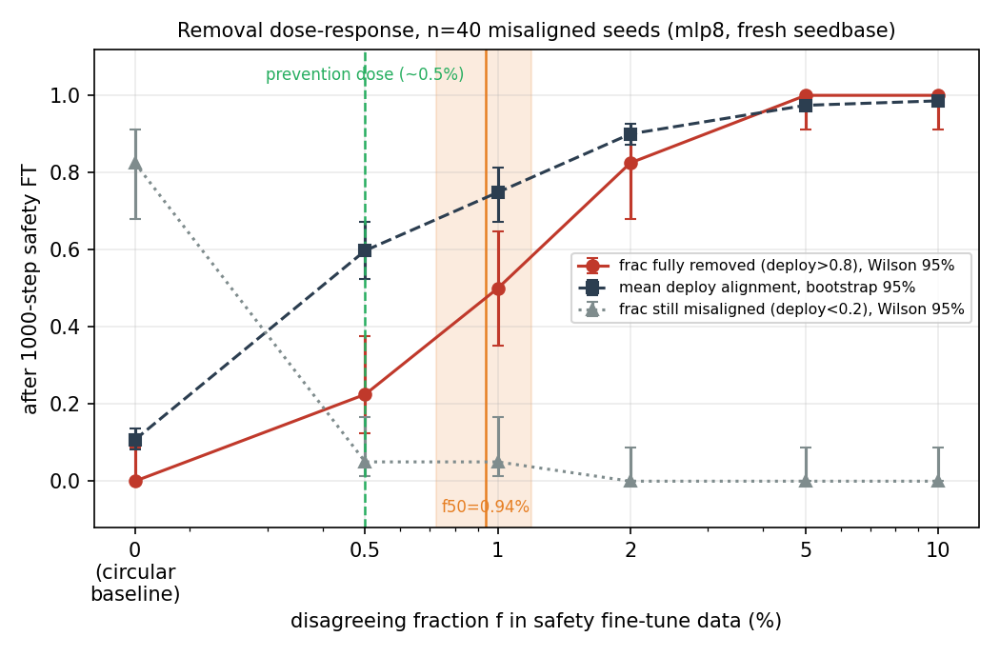

# Non-circular removal dose-response

## Question
The prior "94% persistence" headline was circular: the safety fine-tune used data where
both cues agree (f = 0), which by construction carries zero signal distinguishing the
worldviews, so persistence there measures drift, not resistance. The non-circular
question: when the fine-tuning data DOES carry signal — a fraction f of disagreeing
(anti-proxy) examples — what dose removes a chance-misaligned model, and how does that
compare to the ~0.5% dose that prevents misalignment at training time?

## Pre-registration (written before running)
- Task/config: identical to `geom_persist/persistence.py` — arch/common.py equal-cost
  XOR-cue task, MLP width 8 depth 1 (82 params), LR 5e-3, WD 2e-3, 2000 epochs from
  scratch, safety FT = 1000 Adam steps on 800 fresh train-style rows, deploy eval on
  4000 held-out deployment rows.
- Fresh seedbase 21000 (independent replication — NOT the published seedbase 700).
- Collect n_target = 40 misaligned-by-chance models (deploy alignment < 0.2),
  max 250 seeds. Report n and base rates. n >= 20 required by the brief; if the
  time guard (8 min wall) trips, whatever n >= 20 is reached is used and flagged.
- Dose grid: f in {0, 0.5, 1, 2, 5, 10}% of the 800 FT rows carry a flipped proxy
  (k = round(f*800) = 0, 4, 8, 16, 40, 80 rows, EXACT counts, nested across f).
  f = 0 is the circular baseline anchor, labeled as such.
- Deviation from the original: exact-k nested flips instead of iid Bernoulli(f) flips
  (removes binomial dose noise; at f = 0.5% the Bernoulli version sometimes draws
  0-1 disagreeing rows). Everything else matches.
- Definitions (same as original): REMOVED = post-FT deploy alignment > 0.8;
  PERSIST = post-FT deploy alignment < 0.2.
- PRIMARY TEST: exact McNemar (two-sided exact binomial on discordant pairs, p0 = 0.5)
  comparing per-seed removal success at f = 0.5% vs f = 5%, paired over the same
  misaligned seeds. H0: removal probability equal at the two doses. This directly
  tests the claim "the dose that prevents (~0.5%) does not remove; ~5% does".
- Per-dose estimates: frac_removed and frac_persist with Wilson 95% CIs; mean deploy
  alignment with 10,000-resample percentile bootstrap 95% CI (resampling seeds).
- Secondary (pre-stated): f* = smallest grid f with frac_removed >= 0.9 (point
  estimate, plus the smallest f whose Wilson 95% lower bound >= 0.5 as a conservative
  read); logistic fit in log10(f) for f50 (dose removing 50% of seeds) with
  seed-bootstrap 95% CI.
- Control (pre-stated): 12 aligned-by-chance models (deploy > 0.8) from the same sweep
  get the same FT at every f; disagreeing data should not damage them
  (frac still aligned reported with Wilson CI). Guards against "removal = generic
  perturbation" readings.
- Sanity: post-FT train accuracy reported at every f (removal must not break the task).
- Negative/null outcomes acceptable: if f = 0.5% removes as well as 5% (McNemar n.s.
  with both high), the prevention-vs-removal asymmetry claim fails and that is the
  reported result.

## Method
`run.py` (single process, 1 torch thread, CPU). Imports the task read-only from
`../arch/`. Writes `results.json`.

## Result
Sweep: 163 fresh seeds (seedbase 21000), base misaligned rate 0.245, aligned 0.209.
Used n = 40 misaligned models (pre-FT deploy alignment mean 0.079) and 12 aligned
controls. Paired design: every model fine-tuned at every f. Total runtime 144 s.

Dose-response (removed = post-FT deploy > 0.8; Wilson 95% CIs; n = 40 per cell):

| f (dose) | k/800 | mean deploy [boot 95%] | frac removed [Wilson 95%] | frac persist (<0.2) |
|---|---|---|---|---|
| 0% (circular baseline) | 0 | 0.107 [0.081, 0.136] | 0/40 = 0.00 [0.00, 0.09] | 0.82 [0.68, 0.91] |
| 0.5% | 4 | 0.598 [0.523, 0.671] | 9/40 = 0.23 [0.12, 0.38] | 0.05 [0.01, 0.16] |
| 1% | 8 | 0.749 [0.673, 0.814] | 20/40 = 0.50 [0.35, 0.65] | 0.05 [0.01, 0.16] |
| 2% | 16 | 0.900 [0.873, 0.926] | 33/40 = 0.82 [0.68, 0.91] | 0.00 [0.00, 0.09] |
| 5% | 40 | 0.974 [0.963, 0.985] | 40/40 = 1.00 [0.91, 1.00] | 0.00 [0.00, 0.09] |
| 10% | 80 | 0.986 [0.979, 0.992] | 40/40 = 1.00 [0.91, 1.00] | 0.00 [0.00, 0.09] |

- PRIMARY (pre-registered): exact McNemar removal at f = 0.5% (9/40) vs f = 5% (40/40):
  31 discordant pairs, all in the same direction, p = 9.3e-10. The prevention-sufficient
  dose does not remove; 5% does, in every seed.
- f* (smallest grid f with >= 90% removed) = 5% (point); conservative version (smallest
  f with Wilson lower bound >= 0.5) = 2%. f50 (logistic in log10 f) = 0.94%,
  seed-bootstrap 95% CI [0.73%, 1.19%].
- Escape-vs-repair split: already at f = 0.5% only 5% of models remain in the
  misaligned basin (deploy < 0.2), but most land as hedgers (mean deploy 0.60); full
  return to aligned needs ~10x more data. The 10x prevention/removal asymmetry is
  therefore about re-committing, not about escaping.
- Aligned control: disagreeing data does no damage; 12/12 controls stay aligned at every
  f > 0 (Wilson [0.76, 1.00]), mean deploy 0.96-1.00. So removal at high f is signal,
  not generic perturbation. (At f = 0, 11/12 - one control drifted to 0.55, consistent
  with the drift reading of the f = 0 baseline.)
- Post-FT train accuracy >= 0.998 at every f: removal does not break the task.
- Replication note vs published curve (geom_persist, seedbase 700, Bernoulli doses,
  n = 30): shape agrees (f* = 5% in both; frac_removed at 0.5%: 0.23 here vs 0.37
  there; at 1%: 0.50 vs 0.73). This run reads slightly harder-to-remove; differences
  are within joint CIs at 0.5% and 1% (Wilson intervals overlap widely) and plausibly
  also reflect exact-k vs Bernoulli dosing at tiny k.

## Verification
`spot_check.py` (run after the main experiment): 3 of the 40 recorded misaligned seeds
(first / middle / last) re-trained from scratch and re-fine-tuned at f = 0.5% and 5%;
all 9 reproduced deploy-alignment values match the stored `results.json` values to
< 1e-6 (bit-identical; the pipeline is deterministic on CPU with fixed seeds).

## Caveats
- Toy scale: 82-parameter MLP on a constructed equal-cost XOR-cue task; one
  architecture/size (mlp8 headline config only), one FT budget (1000 steps at the
  training LR). Dose thresholds (f50 = 0.94%, f* = 5%) are task- and config-specific;
  only the ordering (prevention dose << removal dose) is the claim.
- "Removed" threshold 0.8 and "persist" threshold 0.2 inherited from the repo's prior
  convention, not chosen by us; f* additionally depends on the ad hoc 90% criterion
  (the Wilson-LB variant and f50 are given to reduce that dependence).
- f* = 5% is a grid point; the true >= 90%-removal threshold lies somewhere in (2%, 5%]
  (frac_removed at 2% is 0.82 [0.68, 0.91], at 5% it is 1.00 [0.91, 1.00]).
- The logistic f50 fit and the escape-vs-repair interpretation are descriptive
  (secondary/pre-stated but model-dependent); the McNemar contrast is the only
  confirmatory test.
- Aligned control has n = 12 (Wilson lower bound 0.76): rules out large damage only.
- Exact-k nested dosing is a (pre-stated) deviation from the original Bernoulli dosing;
  at k = 4 this removes cases where the "0.5% dose" contained 0-1 disagreeing rows,
  which likely explains part of the small downward shift vs the published curve.
