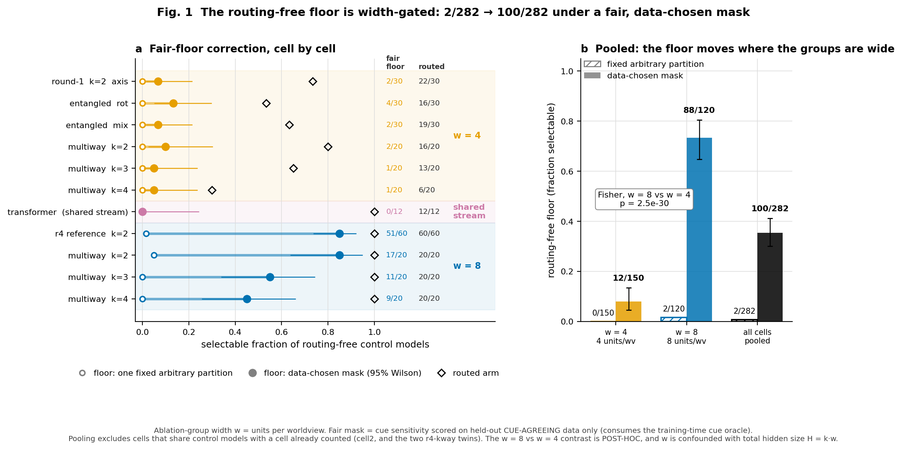
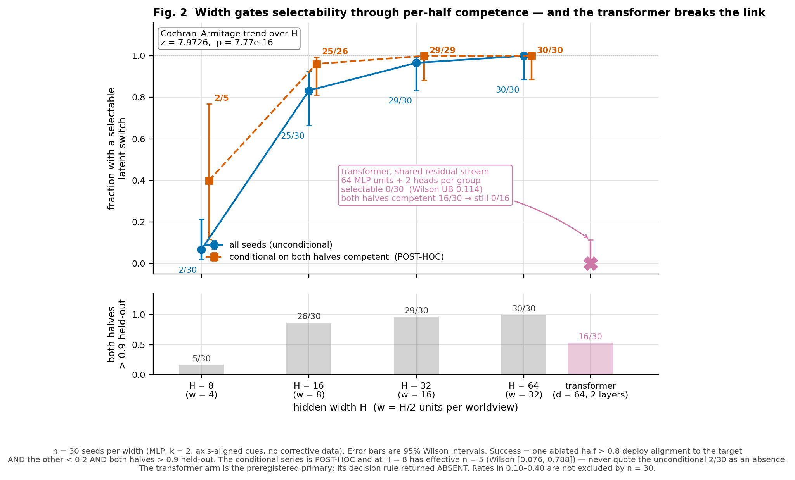
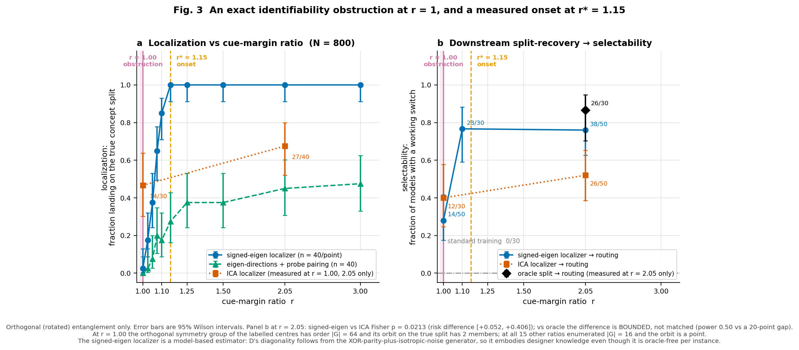
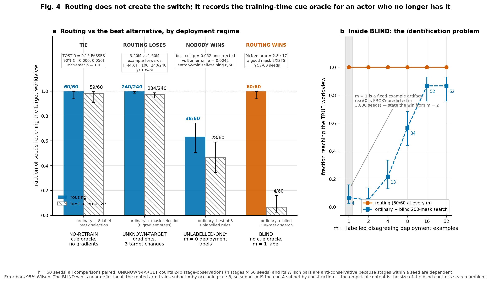
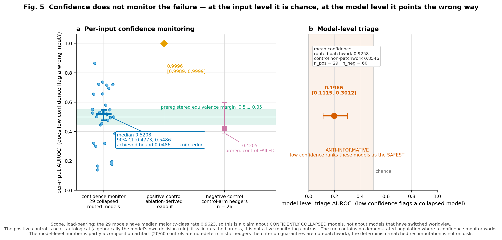

# Routing buys a label, not a switch: capacity and basis conditions for post-hoc worldview selection in underdetermined models

> **Scope, up front and not negotiable — this applies to every claim in the paper and is not repeated.**
> Everything below is toy scale: synthetic tasks with ≤11-dimensional inputs, MLPs of 154–1.2k parameters,
> and one 68,546-parameter from-scratch transformer (G1). The "worldview" is a 2-bit XOR: both cues are
> sign-product (parity) rules on disjoint input coordinate pairs, searched to be equal-cost (G2).
> "Deployment" is a single held-out set on which the two cues disagree; training and held-out data always
> agree (G3). Every mask-selection procedure we report, **including the fair control**, consumes the
> training-time cue oracle — which input dimensions or token positions carry which cue — except two
> localizers that carry their own conditions (G4). **Selectable** is a composite criterion: one ablated half
> > 0.8 deploy alignment toward the target worldview, the other < 0.2, both > 0.9 on held-out *agreeing*
> data (G5). Six independent audits back the numbers (G6). **No claim here licenses any statement about
> frontier models, LLMs, or any system trained at scale.**

Bracketed identifiers (C4, N6, R1, …) are entries in the companion claims ledger (`LEDGER.md`); every claim
in this paper is also indexed in `CLAIMS_TABLE.md` with its n, source directory, audit verdict, preregistration
status, and scope condition.

---

## Abstract

Two rules that agree on all training data and disagree only at deployment leave the choice between them to the
seed. We ask whether that choice can be set after training, by routing each rule's gradient into its own hidden
columns. Five preregistered rounds, three adversarial to our own best result.
(i) The lottery reproduces at two scales: 27 aligned / 27 misaligned / 46 hedgers over 100 MLP seeds, and
deploy alignment 0.000–0.933 across 12 transformer seeds, all at accuracy 1.000 on cue-agreeing data.
(ii) Ordinary training already contains the switch: under a **data-chosen mask** rather than one arbitrary
partition, 51/60 standard models split into two competent halves committed to opposite worldviews; our
headline effect falls from ~+0.98 to **+0.150** at 8 units per worldview (+0.667–0.700 at 4 units; +1.000 in
the transformer). (iii) Selectability is gated by per-half competence and by basis: in one 68.5k-parameter
transformer both halves are competent, yet no axis-aligned mask we built selects (0/30, Wilson upper 0.114).
(iv) Routing's residual value is bookkeeping — it records the training-time cue oracle for a deployment actor
who no longer has it — not tamper resistance. Toy scale throughout; nothing transfers to frontier models by
default.

---

## 1. Introduction

### 1.1 The structural picture

Put two rules in the data that never disagree. A "true" rule and a "proxy" rule, matched in cost, both perfect
on every training example and on held-out data drawn the same way. Nothing in the loss distinguishes them,
because on the training distribution they are the same function. The optimizer is not choosing badly between
them; it is not choosing at all. Which one the network ends up computing is decided by initialization and batch
order, and you find out only at deployment — the one place the two rules come apart.

That is the whole setup, and it behaves exactly as the picture predicts. Over 100 fresh seeds of a small MLP,
all at training accuracy 1.000, the deploy split is 27 aligned / 27 misaligned / 46 hedgers, with a mean deploy
score of 0.509 and a significant Hartigan dip (p = 0.00145, surviving Holm over a 25-regime grid) — a lottery,
not a compromise (C1; MLP only, and this is the only jitter-robust well-fit bimodal cell of 20, so bimodality is
not generic across the grid). It is not an artifact of tiny MLPs. In a 68.5k-parameter from-scratch transformer
where the cue is a circuit rather than a coordinate, 12 seeds all reach held-out accuracy 1.000 while their
deploy alignments span 0.000–0.933 (χ²(11) = 15212.8, p < 1e-300) (C2). In that task the cue genuinely is a
circuit: the token multiset is constant across examples, so a bag-of-tokens model is at Bayes accuracy exactly
0.500 (C3).

So the question is not "which rule does gradient descent prefer". It is: **can the choice be made explicit, and
set after the fact?**

### 1.2 The intervention, and why it should work

Gradient routing gives an obvious mechanism. Split the hidden layer into two column groups, zero the
cross-blocks at initialization, and mask the gradient so the cross-blocks never receive an update. They stay
zero. The layer then decomposes exactly: Δ_full = Δ_A + Δ_B + bias, with additivity residual at most 3.8e-6 and
cross-block max|w| = 0.0 on 30/30 seeds, against 0.882 in a routing-free control (C21). Each surviving column
is its own cue's rule in closed form — the 4-corner XOR truth table read straight off the weights, no fitting,
44/44 columns on switchable seeds (C22), though that readability is a property of the 2-bit generator (G2), not
a discovery about worldviews. Ablate one group and the other's rule is what the model computes. The composite
behaves as a margin race between the two columns (C23), and the ablation dial, though graded at the population
level (transition width W = 0.289, CI excluding the 0.25 rule), is a per-input threshold: 99.96% of the inputs
that change flip exactly once (C24).

The intended reading was: routing turns an unselectable model into a selectable one. We reported that for three
rounds.

### 1.3 What we found, including the part where we broke our own headline

The routing-free control was scored under **one arbitrary fixed unit partition** — a single coin toss over
12,870 possible 8/8 splits — while the routed arm was evaluated under the partition it was built with. Give the
control the same freedom, and derive its mask from data (cue sensitivity on held-out *agreeing* inputs only),
and 51/60 standard-trained models already contain two unit-disjoint, individually competent halves committed to
opposite worldviews. We call that structure the **latent switch**, and the mask that finds it the **data-chosen
mask**: 1/60 → **51/60**, selection margin −0.018 → +0.910 (C4). The mask is measuring something specific, not
fitting noise: independently re-derived on 10 retrained models it finds 8/10 genuine full splits, against 1/50
for random 8/8 splits and 0/10 for noise-dimension masks (C5). Random splits of the *same* models succeed
18/4260 = 0.42% across the portfolio (C10).

Applying one identical rescoring procedure to every routing-free control in the line moves the pooled floor
2/282 → 100/282, and it moves almost entirely where the ablation groups are wide — 88/120 at 8 units per
worldview against 12/150 at 4 (Fisher p = 2.5e-30, POST-HOC, and w is confounded with total hidden size)
(C8). Our previously reported effect of ~+0.98 (R1) becomes **+0.150 [+0.058, +0.261]** at 8
units per worldview (C12) — a sixfold shrink, and that is the number to quote whenever the paper says "routing's
effect size" without qualification. The correction is real but not uniform: of 13 rescored cells, 9 survive, 2
shrink, 2 die (C15). At 4 units per worldview — rounds 1 and 2's actual configuration — routing still
contributes +0.667 and +0.700 (C11), it survives an entangled input basis at +0.400 (rotated) and +0.567
(non-orthogonal mixing) (C13), and in the transformer's shared residual stream the correction changes the number
by exactly zero: 0/12 → 0/12, effect +1.000 (C14).

The same artifact had inflated two other headlines. The k-way claim ("routing creates a 3- and 4-way switch,
20/20 vs 0/20") becomes "routing makes an already-present k-way switch reliable", against fair floors of 11/20
and 9/20; the k = 2 version is refuted outright (C26, R2). And the claim we had treated as the strongest
argument *against* shipping a routed model — "benign fine-tuning erases the switch, 23/23 → 12/23 → 0/30" —
inverts: 44/60 (73%, [0.610, 0.829]) fine-tuned models are still switchable under a data-chosen mask (C56, R3).
What benign fine-tuning destroys is the *labelling*, not the switch; the block-diagonal structure does drift
(C57).

Three headline effect sizes, one artifact, three rounds. We found all three ourselves, and the retraction table
(§6, "What changed across rounds") is a section of this paper rather than an appendix.

**What replaces them is a pair of conditions.** Whether ordinary training leaves a latent switch is a monotone
function of hidden width: 2/30 → 25/30 → 29/30 → 30/30 at H = 8/16/32/64 (Cochran–Armitage z = 7.97,
p = 7.8e-16) (C6). The gate is per-half **competence** — conditional on both data-chosen halves clearing the
**competence gate** (> 0.9 on held-out agreeing data), the mask selects 2/5, 25/26, 29/29, 30/30 (C7, POST-HOC,
and the H = 8 cell has effective n = 5, so "no latent switch at H = 8" is a statement about what n = 5 can
answer, N7). Width is one condition; basis is the other, and they dissociate. In the transformer both
data-chosen halves *are* competent — zero competence failures at the full-model level, held-out min 1.000 — and
the axis-aligned mask still selects **0/30** (Wilson upper 0.1135; best-of-10 random masks 0/30, per-draw 0/300;
fixed partition 0/30) (C17). Capacity is excluded as the explanation: a units-only mask giving each worldview 64
MLP units per layer — 4× the width at which the MLP saturates — leaves both halves competent 12/12 at held-out
1.000/1.000 and still selects 0/12 (C18, POST-HOC). That is a preregistered primary with a prestated power table
(0.87 against a true rate of 0.60), so rates above ~0.11 are excluded and rates in 0.10–0.40 are not (N6). One
organism, one axis-aligned mask family, and **the instrument's positive control is not on disk** — we state the
null with that caveat attached rather than with an instrument check we cannot show.

**So what is routing still for?** We tested four deployment regimes at n = 60, paired. In the **NO-RETRAIN**
regime (cue oracle, no gradients), routing *ties* ordinary training plus a no-gradient intervention, 60/60 vs
59/60, and this is the one genuine equivalence in the line (TOST at δ = 0.15 passes, 90% CI [0.000, 0.050])
(C44, N8). In the **UNKNOWN-TARGET** regime (gradients available), routing *loses*: 100 fine-tuning steps per
target change match it at ~58–60% of the cost, and ordinary training plus mask selection switches target 234/240
with zero gradient steps (C45). In the **UNLABELLED-ONLY** regime, nobody wins, by equivariance (C46). Routing
wins decisively in exactly one regime, **BLIND** — when the deployment actor has **no** cue oracle: 60/60 from
two labels onward, against a fair 200-mask blind search that reaches 3/60 at m = 2 and saturates at 52/60 by
m = 16 (preregistered tie-break row) (C47). That win is near-definitional (subnet A is trained by occluding cue
B, so it *is* the cue-A subnet by construction); its empirical content is the size of the blind control's
identification problem, and the failure there is identification, not existence — a good random mask exists in
57/60 seeds. The honest one-sentence reading: **routing does not create the switch; it records the training-time
cue oracle in the architecture for an actor who no longer has it** (C48). It costs +100% in example-forwards,
and routed models are never usable un-ablated (C49).

**Negative results, stated early.** Routing is not a safety property. Against a hard-deleted switch, a realistic
functional attacker cannot distinguish it from a routing-free model with the same live parameter count —
bounded, not equal, at δ* = 0.065 = 36.5% of the run's own total defense effect (C51, N1). It does beat a
capacity control under a weaker LoRA attacker (d = −0.079, p_perm = 0.0014), but that is the regime where the
attack leaves a broken model (C52). Under the strongest honest attacker the sign flips (+0.093, not surviving
Holm), and that cell is *not* capacity-matched — jitter revives 92 zeroed weights, so the switch trains 154
parameters against the control's 62; it shows dead parameters are an attack surface, not that routing loses to
capacity (C53, R14). And an unselected routed model does not announce itself. It is not a hedger (median
determinism 0.786 MLP, 0.951 transformer, CIs excluding the hedger regime) (C58); it is a confident
off-distribution **class collapse** while scoring 1.000 on held-out agreeing data (C59, POST-HOC); and per-input
confidence does not flag the inputs on which such a collapsed model is wrong (median AUROC 0.521, 90% CI
[0.477, 0.549] inside a preregistered ±0.05 margin, achieved bound 0.0486 — knife-edge) (C60). Two guards
matter here: this is measured on a population whose median majority-class rate is 0.962, so it is a statement
about *collapsed* models, not about models that have switched worldview (R11); and the preregistered negative
control failed, so the run contains no demonstrated population where a confidence monitor works — this is a
limit of confidence monitoring, not a routing-specific liability (C62, N16). Our earlier claim that standard
training never produces this mode is retracted outright: 19/23 transformer controls do (R7). The follow-on
claim that routed models do it *more* was a gate artifact and is dropped (R8).

### 1.4 Contributions

1. **A rescoring result about controls.** A control given only one arbitrary partition understates the
   routing-free floor (1/60 → 51/60) and inflates the reported effect roughly sixfold at 8 units per worldview
   (~+0.98 → +0.150); the same artifact independently inflated three of our own headlines (C4, C8, C12; R1–R3).
2. **Two conditions, dissociated.** Post-hoc selectability under an axis-aligned mask needs per-half competence
   (the width law, C6/C7) *and* a basis in which the two worldviews are axis-separable. The transformer meets
   the first — full competence, 4× the saturating width — and no axis-aligned mask we built meets the second
   (C17/C18). Two independent conditions; width satisfies only one.
3. **An exact mechanism at toy scale.** Routing makes the two-worldview decomposition causal, not merely
   arithmetic, with a closed-form per-column rule and a per-input threshold ablation dial (C21–C24).
4. **An identifiability obstruction and a partial solution.** At exactly equal cue strength (**cue-margin
   ratio** r = 1.00) the orthogonal symmetry group of the labelled centres has order 64 with a 2-element orbit
   on the true split, so any *equivariant* localizer must coin-flip; at all 15 other ratios tested |G| = 16 with
   a single-point orbit (C31). A localizer reading the signed eigen-spectrum of D = E[xx′|y=1] − E[xx′|y=0]
   recovers the true split 40/40 at r = 2.05 and lifts selectability to 38/50 against 26/50 for ICA (Fisher
   p = 0.021) (C32) — for **orthogonal** entanglement, N = 800, r above a measured onset of ~1.15 at N = 800
   (C33), and as a model-based estimator that embodies designer knowledge of the generative family. Whitening,
   ICA's first step, is precisely what destroys the resource it uses, and re-pairing whitened components does not
   repair it (C35).
5. **An exchange rate, corrected.** A few labelled *disagreeing* examples buy localization and a working switch
   where unsupervised localization is obstructed (k* = 4 examples, 0.5% of the training set) (C39), and it is
   the disagreement rather than the data that does the work — 8/30 vs 25/30, p = 2.0e-5, which is a
   **localization** contrast (landing on the true split), not a selectability one (C40). But on a matched
   shipped-subnet outcome, routing does not significantly beat data augmentation at any
   price tested (m = 8: p = 0.052; m = 32: p = 0.49) — our round-4 claim to the contrary had scored the two arms
   on different outcomes — and augmentation reaches a ceiling routing does not (C41, C42, R4).
6. **A selection-hygiene rule.** A max-of-k deflation estimator, validated in simulation (100/100 cells within
   15% of the closed form) (C63), which diagnoses a published 24-layer sweep at ρ̂ = 0.026 and turns a selected
   −2.75 into −0.07 against a fresh truth of +0.22 [−0.72, +1.16] (C64). Its own preregistered real-data primary
   **failed** (p = 0.125) at ~53% power — uninformative rather than disconfirming (C65, N23).
7. **A meta-finding from six audits.** Not one primary statistic failed to reproduce; anchors sit at max|diff| =
   0.0 across rounds, with two disclosed exceptions. Every defect found lived in the interpretive layer: an
   asymmetric outcome definition, a gate applied to one arm, a control given a different scoring rule, a null
   promoted to an equivalence, a diagnostic implemented for one substrate only (C68). Readers should weight the
   measurements and discount the framings — including ours.

### 1.5 What this is not

It is not evidence that frontier models contain latent selectable worldview switches, and not a method for
post-hoc value selection in production systems. The transformer result is 68.5k parameters, one organism, 12–30
seeds; calling it "at scale" would be false. Several of our own success rates are **demonstrations** rather than
effect sizes — where the training mask equals the evaluation mask and the columns are disjoint by construction,
20/20 and 12/12 are existence proofs and nothing more (C20, C25). Where a number is post-hoc it is labelled
post-hoc in the sentence that states it, not only in a methods appendix. Where a null is only a bound, the bound
is quoted instead of the null.

---

## 2. Related work

### 2.1 Underdetermination and goal misgeneralization

The phenomenon we build a toy of is standard. Goal misgeneralization — a policy that retains capability
out-of-distribution while pursuing the wrong objective, because training could not distinguish objectives —
was characterized by Langosco et al. (2022) and Shah et al. (2022). D'Amour et al. (2020) made the statistical
version general: an underspecified pipeline admits many equally-good predictors that behave differently under
shift, and which one you get is an accident of the training run. Related framings include shortcut learning
(Geirhos et al. 2020), the Rashomon effect (Breiman 2001), and the observation that "spurious" features can be
genuinely predictive rather than merely artifactual (Ilyas et al. 2019). Our contribution to this literature is
narrow: we construct the underdetermination deliberately, verify that the two cues are equal-cost, and then ask
a question that literature does not — not *which* rule is learned, but whether the choice remains recoverable
and settable after training. The seed lottery itself is a replication (C1, C2), not a finding.

[CITE: the "simplicity bias" line — Shah et al. 2020 on the pitfalls of simplicity bias — if the author wants the
mechanistic-preference angle; and Rashomon-set / model-class-reliance work (Fisher, Rudin & Dominici) for the
"many equally good models" formalism.]

### 2.2 Gradient routing and localized capability removal

Gradient routing — masking gradients so that a designated data or token subset updates only a designated part of
the network — is due to Cloud et al. (2024), including the expand–route–ablate pattern our setup is a
two-worldview instance of. [CITE: exact author list and venue for the gradient routing paper.] The unlearning
literature supplies the deployment motivation: representation-level removal such as RMU on WMDP (Li et al. 2024),
concept erasure in activation space (Ravfogel et al. 2020; Belrose et al. 2023), and the general finding that
apparent removal is often shallow. Our results cut across that framing in a specific way. Routing is what makes
the decomposition *causal* rather than arithmetic (C21) — but ordinary training already contains the
unit-disjoint halves whenever each half is wide enough and the cues are axis-separable (C4, C6). Routing buys
the *label* on the halves, reliably, for an actor who cannot re-derive it (C47, C48). We know of no prior work
that scores an unrouted control under a data-chosen mask; the closest analogue is pruning/lottery-ticket work,
where a data-derived mask is the object of study rather than a control.

[CITE: Casper et al., "Eight Methods to Evaluate Robust Unlearning"; and the sparse-mask / lottery-ticket line if
the author wants the mask-as-object framing.]

### 2.3 Mode connectivity and the permutation question

That an unrouted network's units can be split into two coherent halves at all is a claim about basis, and the
mode-connectivity literature is the right prior. Garipov et al. (2018) showed distinct SGD solutions are joined
by low-loss curves; Frankle et al. (2020) established linear mode connectivity as a property of stable training;
Entezari et al. (2022) conjectured that most barriers vanish once permutation symmetry is accounted for, and
Ainsworth et al. (2023) gave practical weight-matching algorithms. Our width law (C6) and our basis dissociation
(C17) are, in that language, statements about when a *permutation-selected* partition carries semantics. We do
not test connectivity between the two ablated halves and make no claim about the loss landscape. Note the
confound we cannot remove: in the pooled portfolio, ablation-group width w is confounded with total hidden size
H = k·w, and the width contrast is post-hoc (C8).

[CITE: mechanistic mode connectivity — Lubana et al. (2023) — for the "same loss, different mechanism" version,
which is closest in spirit to our two cues.]

### 2.4 Concept localization: probes, ICA, sparse autoencoders

Finding *where* a concept lives is the step our whole pipeline turns on. Linear probes (Alain & Bengio 2017) and
their descendants; ICA and its identifiability theory (Comon 1994; Hyvärinen & Oja 2000), including the
non-identifiability of the nonlinear case (Hyvärinen & Pajunen 1999); and sparse autoencoders as an
unsupervised dictionary over activations (Bricken et al. 2023; Cunningham et al. 2023; Templeton et al. 2024).
Our results here are unusually specific about a failure mode of the generic recipe. At exactly equal cue
strength there is an *exact* symmetry obstruction — |G| = 64 with a 2-element orbit — so no equivariant
localizer can do better than a coin flip, and the ICA arm and our arm are both at chance there, with the
informative statistic being the landing profile rather than the success rate (C31, C34, N14). Off the symmetric
point the obstruction lifts (|G| = 16, single-point orbit at all 15 other cue-margin ratios), and a signed
second-moment localizer recovers the true split (C32) — but its first ingredient is precisely the one ICA
discards: whitening destroys the asymmetry the estimator reads, and re-pairing whitened components does not
repair it (C35). The prescription "just run a component analysis" is the thing we can rule out on this family.
Two scope limits are load-bearing: the localizer is a model-based estimator embodying knowledge of the
XOR-parity-plus-isotropic-noise generator, and the general non-orthogonal-mixing case is **untested in the
artifact** — an auditor ran it, the numbers are not on disk, and we do not quote them. [LEDGER GAP:
non-orthogonal `mix` localizer cells; C32 covers orthogonal entanglement only.]

[CITE: steering-vector and concept-ablation work the author may want here — activation addition (Turner et al.
2023), contrastive activation addition (Rimsky et al. 2024), concept-ablation fine-tuning, persona vectors. Mark
each only if verified.]

### 2.5 Tamper-resistance evaluation

The safety case for any post-hoc switch depends on what an adversary with the weights can do, and the field's
standard is now that removal must survive fine-tuning (Qi et al. 2023). We report against three attacker
strengths and the results do not line up into a story favorable to routing: bounded-not-equal under a realistic
functional attacker (C51), a win under a weaker LoRA attacker in the regime where the attack breaks the model
(C52), a sign flip under the strongest attacker in a cell that is not capacity-matched (C53). The methodological
point we would like to contribute is the last one: **a defense whose mechanism is zeroed weights is not
capacity-matched to a smaller dense control once the attacker adds jitter**, because the zeros come back (154
trainable parameters vs 62). Any evaluation comparing a sparsified defense to a small dense baseline should
state which parameter count is live under the attack.

[CITE: tamper-resistant safeguards (Tamirisa et al. 2024) and circuit-breakers / representation rerouting (Zou
et al. 2024) — both are the natural comparison points for "make removal survive fine-tuning", but verify the
author lists before citing.]

### 2.6 Selection inflation, preregistration, and audit

The line's methods contribution is defensive. A number chosen as the best of k conditions is biased upward by
roughly a_k·s·√(1−ρ), and the fix is to shrink toward the sweep mean by an estimated ρ̂ (C63) — the garden of
forking paths (Gelman & Loken 2013) in a form you can apply to an already-published sweep. Applied to a
published 24-layer probe sweep, it says there was no layer-to-layer signal to select on (C64) — which licenses
"no layer effect was demonstrated", not "the layer effect is absent". Each round carried a preregistration
stamped before its confirmatory run — but not everything we report is preregistered: the width contrast (C8),
the class-collapse characterisation (C59), the matched exchange rescoring (C41), the margin race and flip
structure (C23/C24) and the resistant-tail analysis (C54) are post-hoc, and are labelled post-hoc where they
are stated. Six independent audits across rounds 4–5 found that every primary statistic reproduced while every
defect lived in the interpretation (C68). That asymmetry is the most transferable thing in the paper:
measurement discipline is comparatively easy to enforce and framing discipline is not.

[CITE: preregistration in ML — if the author has a preferred reference for prereg practice in empirical deep
learning, insert here.]

### 2.7 Model organisms, and the honest position of this work

This is toy-scale mechanism work in the model-organism tradition (Hubinger et al. 2024), where a behavior is
constructed deliberately so that its mechanism can be read out completely. The trade is explicit: we get an
exact causal decomposition (residual 3.8e-6), a closed-form per-column rule, an enumerable symmetry group, and
preregistered power tables — at 154 parameters, on a worldview that is a 2-bit XOR. What we cannot offer is any
evidence about scale. The single organism above 1k parameters is 68.5k parameters, one architecture, one mask
family — and it is the organism carrying our strongest surviving claim, which is a null (the axis-aligned mask
finds nothing despite full competence) with no on-disk instrument check. Whether that generalizes to real
shared residual streams is a hypothesis, and we write it as one.

---

## 3. Setup and methods

Where a design choice buys the result by construction we say so at the point of the choice, not in a limitations
paragraph at the end.

### 3.1 The task: two rules that agree until they don't

The structural picture first. Imagine a labelling job that two different people could do and never
disagree — until one day they meet a case nobody has seen. During training, the network sees only
the cases they agree on. At deployment it sees only the cases they don't. Which person's rule the
network absorbed is then fully visible, and nothing in training touched it.

Concretely: the input carries two cues. A **true** rule and a **proxy** rule, each a sign-product
(parity) function of a disjoint pair of input coordinates, searched to be **equal-cost** so that
neither is the cheaper thing to learn (G2). The training set and the held-out set are both drawn
from the region where the two rules assign the same label. The **deployment** set is the single
held-out set where they disagree (G3).

Two consequences to keep in view throughout:

- The "worldview" here is a 2-bit XOR. When we later say a routed column's rule can be read off
  the weights in closed form with no fitting (C22: 44/44 columns on switchable seeds match the
  4-corner truth table, control 13/60), that is a property of this generator, not a discovery
  about worldviews (G2).
- There is exactly one deployment distribution. Every deploy number is a repeated measurement on
  one distribution, not a test of generalization across distributions (G3).

#### The MLP substrate

A small ReLU MLP, trained to convergence on the agreeing data — training accuracy 1.000, minimum
1.000 across 100 fresh seeds (C1). The smallest configuration has 154 parameters, of which routing
zeroes 92, leaving 62 live (C53); the width-8 configuration has 434 (C16).

The knob we sweep is hidden width H, reported throughout as **w = units per worldview**: H =
8/16/32/64 gives w = 4/8/16/32 (C6). For k = 3 worldviews we use H = 24 and H = 48, i.e. 8 and 16
units per worldview (C27). This distinction is load-bearing — nearly every effect size in the
paper is a function of w — and w is confounded with total hidden size, since H = k·w and no sweep
holds one fixed while moving the other (C8).

[LEDGER GAP: optimizer, learning rate, epoch count, training-set size for the MLP arms, and which
H the 154-parameter count corresponds to, are not recorded in the ledger. The exchange-rate arms
imply a training set on the order of 10³ examples, since m = 4 labelled examples is quoted as 0.5%
of it (C39).]

#### The transformer organism, and why bag-of-tokens is at chance

The MLP substrate has an obvious escape hatch: the cue is a coordinate, so any statement about
"finding the cue in the network" might be a statement about finding a coordinate. The transformer
organism closes it. It is a from-scratch transformer, d = 64, 2 layers, 4 heads, 68,546 parameters,
trained on a sequence version of the same agreeing/disagreeing construction (C2).

The task control is what makes this substrate worth having. The sequences are built so that the
**token multiset carries no information at all**: token-count standard deviation across examples is
exactly 0.0 in both the training and the deploy split, so the Bayes accuracy of any bag-of-tokens
model is exactly 0.500 (C3). A model can only be right by reading order — by running a circuit over
positions. The cue-occlusion intervention used later respects the same constraint: occluding a cue
leaves the token multiset unchanged, changing a mean of 0.98 positions (C3). This statement is
about this task construction only; it is not a general claim about sequence tasks.

### 3.2 What "worldview" means operationally

**Deploy alignment** of a model (or of an ablated half of one) toward a target worldview is the
fraction of deployment inputs — the disagreeing ones — on which its output matches the label that
worldview assigns. 1.000 means it follows that rule everywhere the two rules part company; 0.000
means it follows the other one; 0.5 means it is doing neither cleanly.

**Selection succeeds** on a model when all three of the following hold (G5):

1. one ablated half reaches deploy alignment > 0.8 toward the target worldview (`hi = 0.8`),
2. the other half falls below 0.2 (`lo = 0.2`), and
3. **both** halves score > 0.9 on held-out *agreeing* data (`train_ok = 0.9`).

Leg 3 is the **competence gate**, and it is measured on agreeing data while legs 1–2 are measured on
disagreeing data. That separation is what keeps competence from being scored by the same numbers
that score commitment. The gate is also where the sprint's own worst control error lived, twice: a
competence gate applied to one arm and not the other removed exactly 3 models, all 3 of them
positive cases (R8), and the same gate was implemented as a diagnostic for the transformer and
omitted for the MLP for a full round (C7). When we report a gated number in this paper, the
ungated number is reported beside it.

We call the structure this criterion detects in an ordinarily-trained model the **latent switch**:
two unit-disjoint halves, each individually competent, committed to opposite worldviews off-distribution.

Two derived descriptors are used in the hazard analysis. A model is **committed** if its un-ablated
deploy alignment clears `hi` or falls below `lo`; routed models are never usable un-ablated on this
criterion (0/60 committed either way, mean alignment 0.505, versus 3/60 for ordinary training,
C49). **Determinism** D summarizes how repeatable a model's off-distribution behaviour is, with
D ≤ 0.5 defined in advance as the "hedger" regime (C58). [LEDGER GAP: the exact estimator for D is
not recorded in the ledger.]

### 3.3 The routing intervention

What physically changes: the second-layer weight matrix is written in block form, rows and columns
grouped by worldview, and the **off-diagonal (cross) blocks are zeroed at initialization and never
receive gradient**. The network stops being one net with a structured weight matrix and becomes
two nets that share only the summing readout.

Zeroing a weight is not enough on its own — an ordinary zeroed weight still gets gradient and
comes back on the next step. Routing keeps the block dead by making the forward pass use the masked
weight, so the derivative with respect to every masked entry is identically zero at every step, not
merely small. What the ledger records is the verified outcome rather than the implementation form:
cross-block max|w| = **0.0 on 30/30 seeds**, and a per-parameter gradient trace over cross-block
parameters reading **0/108, 0/144, 0/24** in the k-way configurations (C21, C25). By contrast the
same blocks in an ordinarily-trained control reach 0.882 (C21).

[LEDGER GAP: whether the mask is applied to the weight in the forward pass or to the gradient in
the backward pass is not recorded; the ledger records only that cross-block weights stay at
exactly 0.0 and cross-block gradients are exactly 0.]

The payoff is that the decomposition becomes exact rather than approximate. For a routed net,
Δ_full = Δ_A + Δ_B + bias holds to a maximum residual of **3.81e-6** (C21) — the two columns are
literally separate ~62-parameter subnets plus a summing readout, so ablating one is a causal
intervention and not an approximation. In the control the same arithmetic split exists but is not
causal.

**Partial-routing variants.** To ask how much sharing selection tolerates, six variants relax the
disjointness at fixed architecture, indexed by shared parameters out of total: ceiling (2/434), 25%
unit overlap (28/352), 50% (53/278), a fully shared first hidden layer (130/434), and soft
train-mask leaks at 0.25 (328/434) and 0.50 (396/434 = 91%), plus a 75%-overlap arm (93/212) that
breaks (C16). Two of these break the *leak level* rather than the partition: `shared_trunk` still
shares zero gradient in the later layers, and the soft-leak arms recover the training partition at
Jaccard 1.000/0.996/0.979 (C16). Any reading of the sharing dose-response has to carry that.

### 3.4 Selection

Selection is: pick a group of hidden units, zero them, measure deploy alignment of what remains;
then do the same for the complement. In the MLP the groups are hidden units. In the transformer
the ablation family is **2 heads + 64 MLP units per group, with the mask shared across both
layers** (C14); the mask search space is axis-aligned over 4 heads and 128 MLP units (C17). Every
transformer null in this paper is a null about *that* mask family — one granularity, one organism
(N6).

The dial can also be turned partially, scaling a group's contribution by α ∈ [0,1] rather than
zeroing it, which is how we test whether selection blends worldviews or switches between them
(C24).

### 3.5 Masks: who gets to choose the partition

This is the methodological core of the paper, and it is where three of our own headline results
were wrong.

#### The invalid version

Rounds 1–3 scored the routing-free control under **one arbitrary fixed unit partition** — a single
coin toss over the 12,870 possible 8/8 splits — while the routed arm was scored under the
partition it had been trained with, which is the correct one by construction. The treatment got the
right mask handed to it; the control got a random one. Under that scoring the control scores 1/60
(C4). The same artifact separately inflated the k-way headline (R2) and the benign-fine-tuning
headline (R3).

#### The data-chosen mask (the fair-mask procedure, FMP)

The fix gives the control the same freedom the treatment has: let the data choose the partition,
without letting the deployment set anywhere near it. For each hidden unit, measure **cue
sensitivity** — how much the unit responds to the true-cue coordinates versus the proxy-cue
coordinates — using **held-out agreeing data only**, plus 4000 unlabelled train-mode inputs, and
assign each unit to whichever cue it is more sensitive to. The deployment set is used only to score
the resulting mask, never to choose it. Throughout this paper, the **fair-mask procedure (FMP)** is
this procedure, the **data-chosen mask** is its output, and the **fair floor** is the routing-free
control's success rate under that mask.

The honest cost, stated once and inherited by every mask number in this paper: **this procedure
consumes the training-time cue oracle** — it needs to know which input dimensions (or which token
positions) carry which cue (G4). It is not an unsupervised discovery procedure. Only the localizers
in §3.6 attempt that.

Under FMP the same 60 control models score **51/60** instead of 1/60, with selection margin +0.910
against −0.018 [−0.097, +0.061] for the fixed partition (C4). One identical FMP was then applied to
every routing-free control in the line: pooled 2/282 → 100/282 (C8). FMP was verified bit-identical
to round 4's rule (max|diff| = 0.0, masks identical 10/10, C8).

#### Controls on the mask itself

A mask procedure that finds anything at all is worthless unless a bad mask finds nothing. Four
negative controls, preregistered:

- **Random balanced splits of the same models**: 1/50 in the re-derivation (Fisher p = 1.5e-7,
  C5); pooled over distinct model sets in the portfolio, **18/4260 = 0.42%** (C10).
- **Best-of-10 random masks**, which gives the control K = 10 draws against the method's 1 — the
  method still wins per width at McNemar p = 1.0 / 2.7e-4 / 2.4e-7 / 1.5e-8 (C6).
- **Noise-dimension masks** (masks built from cue-irrelevant input dimensions): 0/10, p = 7.1e-4
  (C5).
- **Distractor mask** in the transformer: 0/30 (C17).

Independent re-derivation on 10 models retrained from scratch reproduces 8/10, all under the
designated rather than the swapped mapping (C5). Note what this is: an independent re-derivation,
not a fresh-seed replication (C5).

### 3.6 Localizers

The FMP consumes the cue oracle. The localization experiments ask what is recoverable without it,
in an entangled input basis where the cues are not coordinates. Four procedures are compared on the
same seeds:

1. **Oracle** — the generator's true coordinate split. Upper reference, not a method.
2. **Round-2 pair probe** — a data-only probe that recovers the k true cue groups exactly, 20/20
   at k = 3 (chance 1/1260) and 20/20 at k = 4 (chance 1/17325), permuted-label null 0/20 at both
   (C28). Its condition is severe and was found only in round 3: it needs the concepts to already
   occupy disjoint axis-aligned input columns, and *that coordinate system is itself oracle
   information* (R5). It also returns groups in an arbitrary slot order, matching the oracle on
   10/20 seeds at k = 3 and 14/20 at k = 4 (C29).
3. **ICA** — round 3's basis-agnostic localizer. Collapses in every basis tested (axis_ica 13/30 vs
   axis_pair 25/30, Fisher p = 0.0028; rot_ica 16/30; rot_dict 8/30; mix_ica 19/30, C37).
4. **Signed eigen-spectrum of D = E[xx′|y=1] − E[xx′|y=0]** — take the class-conditional
   second-moment difference, read its signed eigen-spectrum, take the eigen-directions as the
   candidate concept axes and pair them by the *sign and magnitude asymmetry* of the spectrum
   (C32).

Localizer 4 is evaluated against a swept **cue-margin ratio r** (the ratio of the two cues'
strengths; r = 1.00 is exactly equal cues) at N = 800 and N = 3200. It is a model-based estimator:
D's diagonality follows from the XOR-parity-plus-isotropic-noise family, so it embodies designer
knowledge of the generative family even though it is oracle-free per instance (C32). A preregistered
2×2 separates its two ingredients — directions (eigen vs ICA) × pairing (asymmetry vs probe) —
which is what identifies whitening as the destructive step (C35).

### 3.7 Attacker models in the tamper evaluation

Two deployment stories, and they have different threat models.

**Shipped model plus an inference-time mask.** An adversary holding the weights flips the worldview
by flipping the mask: 0 gradient steps, 0 data, hard-set versus masked at max|diff| = 0.0
(C50: 23/23 in round 3, 60/60 in round 4). This is structural; there is no attacker to model.

**Shipped model with the unselected half hard-deleted.** Here there is an attack, and the
comparison needs a control matched on live capacity. Two controls are used: a **capacity control**
(a routing-free H = 4 model with the identical 62 live parameters) and a **corrected baseline**
(round 3's PRIMARY A1 arm), plus a no-defense arm to calibrate the equivalence machinery (C51,
C52, R12).

Attacker rungs, weakest to strongest:

- **LoRA** — the preregistered weak attacker. Note its regime: it leaves broken models, with only
  26.7% (switch) and 16.7% (control) still competent at step 100, against 68.3% for the corrected
  baseline (C52).
- **Functional** — the realistic attacker, and the one the headline equivalence bound is computed
  under (C51).
- **Full fine-tuning**, and **full fine-tuning + 1% weight jitter** — the strongest honest rung
  (C53).

Outcome metrics: the area under the attack trajectory (mean AUC9 is quoted, e.g. 0.560/0.467 for
full-FT+jitter versus 0.767/0.786 for the best LoRA cell, C53), whether the model has flipped at
step 100 (N2), and capped flip time (N3).

Two artifacts must travel with these numbers. Bare full-FT rungs (−0.159, −0.251) are a
**relu′(0) = 0 artifact** and are greyed out wherever plotted (C53). And the jitter rung is **not
capacity-matched**: jitter revives the 92 zeroed weights, so the switch trains 154 parameters
against the control's 62 (C53).

### 3.8 Preregistration and power protocol (adopted after round 3)

From round 4 on, every confirmatory run followed the same protocol.

- **Prereg written and stamped before the run.** Primaries, decision rules, thresholds, and
  negative controls are fixed in the prereg file; amendments are stamped before the confirmatory
  run they affect (C39). Decision rules are executed *by code* against the prereg, not by a human
  reading the numbers afterwards — the transformer primary's decision "ABSENT" was applied that way
  (C17). [LEDGER GAP: the mtime-based verification of prereg stamping is not itself recorded in the
  ledger.]
- **Power stated in advance, as a table, not as a word.** The transformer primary shipped with a
  prestated power table of 0.15/0.52/0.87/0.98/1.00 against true rates 0.40/0.50/0.60/0.70/0.85
  (C17); the localizer primary shipped with design power 0.92 (C32).
- **Nulls are reported as bounds, never as absences.** Where a comparison comes out null we report
  a TOST or an achieved equivalence bound δ* and the only reading it licenses. Exactly one genuine
  equivalence exists in the whole line — routing versus ordinary training plus a no-gradient
  intervention, TOST at δ = 0.15 passing with 90% CI [0.000, 0.050] (C44/N8). Everything else is a
  bound: the tamper comparison achieves δ* = 0.0648 against a preregistered 0.05 margin it missed
  at ~36% power (C51/N1), and the monitor equivalence is knife-edge at 0.0486 against a 0.05 margin
  (C60/N15). Promoting a null to an equivalence is one of the five defect types the audits found
  (C68).
- **Standard test choices.** Fisher exact for 2×2 counts, McNemar for paired designs, Wilson
  intervals for single proportions, Newcombe for risk differences, Cochran–Armitage for ordered
  trends, permutation p-values where the statistic is not standard (reported at the permutation
  floor, e.g. p_perm = 5e-5 at 20k permutations, C39), and Holm within a declared family (C52: Holm
  over 7 tests).
- **Selection-inflation discipline.** Any number chosen as the maximum over a sweep is deflated by
  θ̂ = D̄ + ρ̂(D_sel − D̄) with ρ̂ = max(0, 1 − s²/S²), validated in simulation against the closed
  form a_k·s·√(1−ρ) at 100/100 cells within 15% (C63). For max-of-|·| statistics the two-sided
  constant b_k = E[max|N(0,1)|] replaces a_k — b_4 = 1.4647 against a_4 = 1.0294, a factor of 1.423
  (C66). The rule's preregistered real-data primary **failed** (exact Wilcoxon W = 9, p = 0.125) at
  ~53% power, which makes it uninformative rather than disconfirming (C65/N23), and that failure is
  stated in the same breath as the simulation success wherever the rule is used.
  [LEDGER GAP: the design rule n ≥ (a_k·σ_w/δ)² used to size sweeps is not recorded in the ledger;
  what is recorded is the closed form a_k·s·√(1−ρ) it derives from (C63).]
- **Anchors on every rerun.** Each round re-ran at least one prior round's cell and reported
  max|diff| against the stored result. Across six audits every anchor came back at max|diff| = 0.0,
  with two disclosed exceptions: a 0.0255 anchor in the k-way run (an undeclared override of that
  prereg's own rule) and a 5e-5 anchor traceable to 4-decimal storage precision, with per-seed
  booleans exact (C68).

### 3.9 What counts as a fair control

This is the lesson the sprint actually produced, and it is worth stating as a rule set rather than
a moral. Across six independent audits in rounds 4–5, **not one primary statistic failed to
reproduce**; every defect found was in the interpretive layer (C68). The measurements were fine.
The comparisons were not.

The five defect types found, each with the claim it damaged:

1. **A control given a different scoring rule than the treatment.** The routed arm was scored under
   the partition it was trained with; the control under one arbitrary partition out of 12,870
   (C4/R1). Cost: three headline effect sizes across three rounds (R1, R2, R3).
2. **An asymmetric outcome definition.** Routing was scored two-sided (both subnets had to behave)
   and augmentation one-sided (one aligned model). Rescored on the matched outcome, the p-values
   moved from 0.0046 and 0.024 to 0.052 and 0.49 (C41/R4).
3. **A gate applied to one arm.** A competence gate removed 3 models from the routed arm and none
   from the control; all 3 were positive cases (R8).
4. **A null promoted to an equivalence.** A bounded non-difference reported as sameness (C68, and
   the null-reporting rules that now govern every null in this paper).
5. **A diagnostic implemented for one substrate only.** The competence-conditional analysis existed
   for the transformer and not the MLP for a full round (C7).

The operational rules we now apply, each of which would have caught one of the above:

- **Same degrees of freedom.** If the treatment gets to choose its mask, the control chooses one
  too, by the same procedure. If that is impossible, give the control *more* freedom than the
  treatment (best-of-10 random masks against the method's 1, C6) and report the comparison anyway.
- **Same outcome, both arms, written down before scoring.**
- **Same gates, both arms; ungated numbers reported alongside gated ones.**
- **The right floor, not the convenient one.** For a routed arm the honest floor is
  routing-with-a-broken-split (rot_pair 10/30, pooled 18/60), not standard training at 0/30 — the
  round-3 agent volunteered this against its own result (C37).
- **A null gets a bound and a prestated reading, or it does not get reported.**
- **Every diagnostic runs on every substrate it is defined for.**
- **Anchor every rerun** against the stored prior result and publish max|diff|.

One caution about that list: it is a rule set for catching *our* errors, derived from five rounds
on one toy line. It has not been validated as a general protocol, and the "right floor" rule in
particular required knowing what the honest floor was — which is a research result, not a
checklist item.

---

## 4. Results

Several headline numbers in this line changed sign or magnitude between rounds; each such change is flagged in a
**What changed** aside at the point where the final number appears, and all of them are collected in §6.

### 4.1 Underdetermination reproduces at both scales

**Structural picture.** Two rules label the training data identically. Nothing in the loss distinguishes
them. Training therefore does not pick between them on the merits; the seed picks.

**MLP (n = 100 fresh seeds, equal-cost regime, width 8).** Train accuracy 1.000 (min 1.000). Deploy score
mean 0.509, splitting **27 aligned / 27 misaligned / 46 hedgers**. Hartigan dip p = 0.00145 (bootstrap
0.0008), surviving Holm over the 25-regime grid [C1]. *Scope:* this is the only jitter-robust well-fit
bimodal cell of 20 in that grid. Five of the other rejections are the underfit W = 2 row and three are
discreteness artifacts, so bimodality is a property of this regime, not of the grid.

**Transformer (n = 12 control seeds, 68.5k params, d = 64, 2 layers, 4 heads).** All 12 at held-out
accuracy 1.000, with deploy alignment spanning **0.000–0.933** (std 0.293). Homogeneity χ²(11) = 15212.8,
p < 1e-300 [C2]. Preregistered primary (χ² p < 0.001 and ≥3 seeds committed).

**The transformer's cue is a circuit, not a token statistic.** Token-count standard deviation across
examples is exactly 0.0 in both train and deploy, so a bag-of-tokens model has Bayes accuracy **0.500**;
occlusion changes a mean of 0.98 positions and leaves the token multiset unchanged [C3]. The lottery is
therefore over which *circuit* the model builds, not over which surface statistic it latches onto.

### 4.2 The routing-free floor was mis-scored, and the corrected floor is width-gated

**Structural picture.** Ablating "half the network" requires choosing which half. Rounds 1–3 scored the
routing-free control under one arbitrary fixed unit partition — a single coin toss over 12,870 possible
8/8 splits — while the routed arm was scored under the partition it was trained with. Give the control
the same freedom to choose its mask from data, and much of routing's apparent effect is already sitting
in ordinary training.

#### 4.2.1 The correction

At the round-4 configuration (H = 16, w = 8 units per worldview, MLP, axis-aligned cues), n = 60
identical standard-trained models score **1/60** under the arbitrary fixed partition and **51/60**
(0.85, Wilson [0.739, 0.919]) under a data-chosen mask (cue sensitivity on held-out *agreeing* data only).
Selection margin −0.018 [−0.097, +0.061] fixed vs **+0.910** data-chosen [C4]. The fair-floor rescoring
was not the run's preregistered primary; it is the run's self-refutation, disclosed as such.

The mask is measuring something specific rather than fitting noise. Re-derived independently on 10
retrained control models it succeeds **8/10**, all under the designated (not swapped) mapping, every mask
a genuine full 8/8 split; random 8/8 splits succeed **1/50** (Fisher p = 1.5e-7) and masks built on noise
dimensions **0/10** (p = 7.1e-4) [C5]. *Scope:* seeds 700–709 retrained from scratch, an independent
re-derivation rather than a fresh-seed replication.

Random splits of the *same* models almost never work: **18/4260 = 0.42%** over distinct model sets
(21/5660 = 0.37% if cells sharing controls are counted twice) [C10].

#### 4.2.2 The width law (Figure 1)

**Structural picture.** The data-chosen mask can only succeed if each half, alone, has enough units to
compute the rule. Widen the layer and the floor climbs.

The data-chosen mask succeeds **2/30 → 25/30 → 29/30 → 30/30** at H = 8/16/32/64 (4/8/16/32 units per
worldview), n = 30 seeds per width. Cochran–Armitage **z = 7.9726, p = 7.77e-16**. Per-width McNemar
against best-of-10 random masks: 1.0 / 2.7e-4 / 2.4e-7 / 1.5e-8 [C6]. *Scope:* MLP, k = 2, axis-aligned
cues, no corrective data; the random-mask control gets K = 10 draws to the method's 1. The **trend** was
preregistered; **reading it as a law is post-hoc**.

Applying one identical fair-mask procedure to every routing-free control in the line moves the pooled
floor **2/282 → 100/282**, and the movement is concentrated where the ablation groups are wide:
**w = 8: 2/120 → 88/120 (73.3%)** vs **w = 4: 0/150 → 12/150 (8.0%)**, Fisher **p = 2.53e-30** [C8]
(Figure 1). The rescoring itself was preregistered (13 cells, per-cell verdict rule fixed in advance) and
verified bit-identical to round 4's rule (max|diff| = 0.0, masks identical 10/10). **The w = 8 vs w = 4
contrast is POST-HOC**, w is confounded with total hidden size H = k·w, and the pooled cells differ in k
and in input basis. Descriptive only.

> **Figure 1. The routing-free floor is width-gated: 2/282 → 100/282 under a fair, data-chosen mask.**
> (a) Fair-floor correction, cell by cell. (b) Pooled: the floor moves where the groups are wide.
> Ablation-group width w = units per worldview. Fair mask = cue sensitivity scored on held-out
> cue-agreeing data only (consumes the training-time cue oracle). Pooling excludes cells that share
> control models with a cell already counted (cell2, and the two r4-kway twins). The w = 8 vs w = 4
> contrast is POST-HOC, and w is confounded with total hidden size H = k·w.
> [LEDGER GAP: the fair-floor rescoring of the *routed* arms exists only for `anchor_disjoint_w4` (22/30)
> and `ceiling_disjoint_w8` (60/60); every other D_new in this figure and in §4.2.3 is therefore an
> **upper bound**.]

Post-hoc corroboration: across cells, fair-floor rate tracks column competence at Pearson **r = +0.764**;
median column held-out accuracy is 0.99 with 80–93% of columns above the competence gate at w = 8, against
0.81–0.87 with 28–42% above it at w = 4 [C9]. *Scope:* **POST-HOC**, n = 10 non-independent cells (three
pairs share byte-identical control models), no confidence interval.

#### 4.2.3 What routing is left with

| Configuration | Routed | Fair floor | D_new | Source |
|---|---|---|---|---|
| Round 1, w = 4, H = 8, axis | 22/30 | 2/30 | **+0.667** [0.436, 0.801], Fisher 1.45e-7 | [C11] |
| Round 2, w = 4, learned localizer | 23/30 | 2/30 | **+0.700** [0.471, 0.825] | [C11] |
| Round 4, w = 8, H = 16 | 60/60 | 51/60 | **+0.150** [+0.058, +0.261], Fisher 0.0028 | [C12] |
| Rotated basis, w = 4 | 16/30 | 4/30 | **+0.400** [0.163, 0.583], Holm 0.0065 | [C13] |
| Non-orthogonal mixing, w = 4 | 19/30 | 2/30 | **+0.567** [0.336, 0.722], Holm 6.2e-5 | [C13] |
| Transformer, shared residual stream | 12/12 | 0/12 | **+1.000** [0.657, 1.000], Holm 8e-6 | [C14] |

Rounds 1 and 2 share control models and count once. The +0.150 at w = 8 is the number to quote whenever
the paper says "routing's effect size" without qualification [C12]. The two entangled-basis rows are
**conservative**: their routed arms used oracle-free learned localizers while their floors got the cue
oracle [C13]. The transformer row is the only cell in the portfolio where the fair-floor correction moves
the number by exactly zero [C14].

Of the 13 rescored cells, **9 survive, 2 shrink, 2 die** under a verdict rule fixed before any code was
written [C15]. "DIES" is not "no effect": k = 4 / w = 4 dies at D_new = +0.250 with a Newcombe CI
[0.008, 0.473] that excludes zero and a Holm p of 0.183 — unestablished at n = 20, and the tension
between the two summaries should be stated rather than resolved [N19]. k = 2 / w = 8 dies at +0.150
[−0.038, 0.360], Holm 0.231; the original 20/20-vs-1/20 claim is refuted outright, and the residual
effect is not established in either direction [N20]. In only two configurations were the *routed* arms
also rescored under a data-chosen mask, so elsewhere D_new is an **upper bound** [C15].

> **What changed.** Rounds 1–3 published "routing makes the worldview selectable, 22/30 (later 60/60)
> vs 0/30 — a ~+0.98 effect" [R1]. That floor was one arbitrary partition. The same artifact inflated
> two further headline claims in later rounds (§4.6, §4.8). Nothing in the underlying measurements moved:
> the round-1 anchor reproduces at max|diff| = 0.0 on 22/30 identical booleans.

**Selectability needs private capacity, and tolerates a lot of sharing short of that.** Under the
training partition: ceiling (2/434 shared params) 60/60; 25% unit overlap 60/60; 50% overlap 58/60;
fully shared first hidden layer 60/60; soft train-mask leak 0.25 60/60; leak 0.50 (91% of params shared)
59/60; **75% overlap collapses to 2/60**, Cochran–Armitage over the overlap dose z = −11.73 [C16]. The
collapse is not a competence failure: 0 of 58 misses are competence misses and median held-out accuracy
is 1.000. The break is also partial — the shared-trunk arm shares zero gradient in the later layers, so
selection still acts on disjoint columns, and the soft-leak arms break the leak level rather than the
partition (learned masks recover the training partition at Jaccard 1.000/0.996/0.979). Sharing and
private width are confounded: there is no width sweep at fixed overlap. Under the *data-chosen* mask the
same arms score 60/60, 50/60, 27/60, 0/60, so the sharing dose-response is a statement about the **true**
mask.

### 4.3 The gate is per-half competence — and the transformer dissociates it from selection

**Structural picture.** Two things have to be true for post-hoc selection to work: each half must be able
to compute a rule alone (competence), and the two halves must have committed to *different* rules
(commitment). Width buys the first. The transformer shows the first without the second.

#### 4.3.1 In the MLP, competence is the gate (Figure 2)

Both data-chosen halves clear the competence gate in **5 / 26 / 29 / 30** of 30 seeds at H = 8/16/32/64.
Conditional on both being competent, the mask selects **2/5, 25/26, 29/29, 30/30** [C7] (Figure 2).
*Scope:* **POST-HOC** — the preregistration committed to reporting competence-dominated failures, and the
diagnostic was implemented for the transformer but omitted for the MLP until this analysis. The H = 8
conditional cell has effective n = 5 (Wilson [0.076, 0.788]).

This is why the unconditional 2/30 at H = 8 must never be quoted as "no latent switch at round 1's
width". The defensible statement is: **at H = 8 the halves are too small to answer the question** [N7].

> **Figure 2. Width gates selectability through per-half competence — and the transformer breaks the link.**
> n = 30 seeds per width (MLP, k = 2, axis-aligned cues, no corrective data). Error bars are 95% Wilson
> intervals. Success = one ablated half > 0.8 deploy alignment to the target AND the other < 0.2 AND both
> halves > 0.9 held-out. The conditional series is POST-HOC and at H = 8 has effective n = 5 (Wilson
> [0.076, 0.788]) — never quote the unconditional 2/30 as an absence. The transformer arm is the
> preregistered primary; its decision rule returned ABSENT. Rates in 0.10–0.40 are not excluded by n = 30.
> [LEDGER GAP: C17 states "0 competence failures" for the transformer arm, which is the **full-model**
> count (`n_competence_fail = 0`). Recomputing the **per-half** gate from `arms['TF-A'].per_seed`
> (`learned.tA ≥ 0.9 AND learned.tB ≥ 0.9`) gives 16/30 seeds with both halves competent, and 0/16
> conditional selectable. The figure plots that honest recomputation. The stronger "both halves competent
> 12/12" figure is C18's units-only granularity arm (n = 12), a different mask family. The author must
> reconcile C17's wording with the per-half recount.]

#### 4.3.2 In the transformer, competent halves still do not select

n = 30 transformer control seeds, data-chosen head+MLP-unit mask: **0/30** selected (Wilson 95% upper
**0.1135**). Best-of-10 random balanced masks 0/30 (per-draw 0/300); fixed partition 0/30; distractor
mask 0/30; McNemar vs random p = 1.0. **Zero competence failures at the full-model level**, held-out
minimum 1.000. The preregistered decision **ABSENT** was applied by code [C17].

Capacity is excluded. A units-only mask hands each worldview **64 MLP units per layer** — 4× the width
at which the MLP saturates. Both halves are competent 12/12 at held-out 1.000/1.000, mean selection
margin 0.073, and selection is still **0/12**. Heads-only: 0/12, 9/12 competent, margin 0.114 [C18].
*Scope:* **POST-HOC**, n = 12, same single mask family.

An independently retrained transformer set says the same thing descriptively: under the fair-mask
procedure 79% of data-chosen groups pass the competence gate, yet both groups land mid-alignment on
9/12 seeds (median deploy alignment ≈ 0.50 A-side, 0.44 B-side), and only 4/12 seeds recover a contiguous
head split [C19]. *Scope:* **POST-HOC**, n = 12, one organism.

**Two independent conditions, and width satisfies only one.** Competence is necessary and width buys it;
commitment along an axis-aligned mask family is separate, and in a shared residual stream we could not
find it.

*Limits of this null.* One organism, one mask-granularity family (axis-aligned, shared across both
layers, over 4 heads and 128 MLP units). The prestated power table is 0.15/0.52/0.87/0.98/1.00 against
true rates 0.40/0.50/0.60/0.70/0.85 — so **rates above ~0.11 are excluded; rates in 0.10–0.40 are not**
[N6]. [LEDGER GAP: the mask-finder's positive control on routed transformers — reported elsewhere as
4/4 with head recovery 1.00 and unit recovery 0.71 — is not on disk, so this null currently has no
instrument check. Either recompute it or state the null without one.]

Routing does make the worldview selectable in that same transformer: competence-gated **11/12 vs 0/12**,
Fisher p = 9.61e-6 (ungated 12/12 vs 0/12, p = 7.40e-7), with every routed seed at selA_deploy 1.000 and
selB_deploy 0.000 [C20]. This is a **demonstration, not an effect size**: each routing group is trained
in isolation under exactly the ablation mask it is later evaluated with. Occlusion alone gives 3/12
(p = 0.217, underpowered) [N22].

### 4.4 Localization: an exact obstruction, and a narrow way around it

**Structural picture.** Routing needs to be told which subspace is which. If the cues sit in known input
columns, that is free. If the input basis is entangled, someone has to find the split — and at exactly
equal cue strength there is a symmetry that makes finding it impossible for a whole class of methods.

#### 4.4.1 The obstruction is exact, and it is knife-edge

Exact enumeration over 16 cue-margin ratios: at r = 1.00 the orthogonal symmetry group of the labelled
class centres has order **|G| = 64** and its orbit on the true split has **2** members, so any equivariant
localizer must coin-flip between them. At all 15 other ratios **|G| = 16** with orbit **1** [C31]. This
is a statement about equivariant localizers on this generative family. It does not say no localizer can
exist away from the symmetric point.

Measured behaviour matches: at r = 1.00 the signed-eigen localizer lands on the true split **14/50**,
with a landing profile of true 1 / entangled 2 / **neither 47** — degenerate eigenspaces produce a random
split [C34]. Against ICA at the same point, 14/50 vs 12/30 (Fisher p = 0.327, risk-difference CI
[−0.326, +0.086], power 0.365): both are coin flips there, and the landing profile rather than the rate
is the informative statistic [N14].

> **What changed.** Round 3 concluded "no unsupervised localizer can exist / the degeneracy is not
> knife-edge in cue strength" [R6]. Exact enumeration showed the obstruction holds *only* at exactly
> equal cue strength.

#### 4.4.2 What the signed-eigen localizer buys (Figure 3)

Read the signed eigen-spectrum of D = E[xx′|y=1] − E[xx′|y=0]. Off the symmetric point it recovers the
true concept split **40/40** at r = 2.05 (binomial vs 0.5, p = 9.1e-13), with predicted spectrum
(−8, +8, −33.62, +33.62) against observed (−8.000, +7.998, −33.606, +33.673). Downstream selectability
**38/50 vs 26/50** for round 3's ICA localizer on the same seeds, Fisher **p = 0.0213**, risk difference
+0.24 [+0.052, +0.406]; against standard training, 38/50 vs 0/30, p = 2.02e-12 [C32] (Figure 3).

*Scope, load-bearing:* **orthogonal (rotated) entanglement only**, N = 800, r ≥ 1.15. It is a
**model-based estimator** — D's diagonality follows from the XOR-parity-plus-isotropic-noise family — so
40/40 is a numerical confirmation of exact algebra. It is oracle-free per instance while embodying
designer knowledge of the generative family.

[LEDGER GAP: the paired McNemar version of this primary (reported elsewhere as p = 0.017) is not on
disk; the Fisher p = 0.0213 above is the on-disk value.]

Only the **magnitude** of the asymmetry matters, not which cue is stronger: at r = 0.4878 and r = 0.80,
where the proxy is the stronger cue, the localizer still lands true 40/40 (fidelity 0.9986 / 0.9932)
[C36].

Recoverability has a measured onset that moves with sample size: r* (Wilson lower bound > 0.90) = **1.15
at N = 800** and **1.07 at N = 3200**, so the excess (r*² − 1) falls 0.3225 → 0.1449, ratio **0.449**,
inside the preregistered N^(−1/2) window [0.35, 0.71] [C33]. *Caveat:* the N = 200 leg is right-censored
by a too-short grid and **failed** its own check, so the scaling claim rests on one ratio, not a fitted
exponent.

Against the oracle at r = 2.05 the localizer is 38/50 vs 26/30 (Fisher p = 0.387), risk-difference CI
[−0.263, +0.083], power 0.502 against a 20-point difference: **bounded, not matched** [N13].

> **Figure 3. An exact identifiability obstruction at r = 1, and a measured onset at r* = 1.15.**
> (a) Localization vs cue-margin ratio (N = 800). (b) Downstream split-recovery → selectability.
> Orthogonal (rotated) entanglement only. Error bars are 95% Wilson intervals. Panel (b) at r = 2.05:
> signed-eigen vs ICA Fisher p = 0.0213; vs oracle the difference is BOUNDED, not matched (power 0.50
> against a 20-point gap). At r = 1.00 the orthogonal symmetry group of the labelled centres has order
> |G| = 64 and its orbit on the true split has 2 members; at all 15 other ratios enumerated |G| = 16 and
> the orbit is a point. The signed-eigen localizer is a model-based estimator: D's diagonality follows
> from the XOR-parity-plus-isotropic-noise generator, so it embodies designer knowledge even though it is
> oracle-free per instance. ICA appears as two points (n = 30 at r = 1.00, n = 40 at r = 2.05) from
> different arms, not as a curve; the oracle is a single marker measured at r = 2.05 only.

#### 4.4.3 Rotation invariance, non-orthogonal mixing, and the whitening warning

Invariance to orthogonal change of basis is **free by construction**: the estimator is exactly
orthogonally equivariant, so a rotated problem is the same problem. This is an analytic property of the
estimator, stated as such. [LEDGER GAP: the empirical axis-vs-rotated comparison (reported elsewhere as
20/20 = 20/20) is not on disk and is not cited here.]

Under general non-orthogonal mixing the guarantee goes away, and this case is **untested in the
artifact**. [LEDGER GAP: the reported degradations to 13/20 at r = 2.05 and 17/20 at r = 3.00 are
auditor-run and not on disk; the scope limit is real and stated without them.]

**The whitening warning.** ICA's first step destroys exactly the resource this localizer uses. A
preregistered 2×2 at r = 2.05: eigen-directions + asymmetry pairing **40/40**; ICA directions + asymmetry
pairing **18/40**; eigen-directions + probe pairing **18/40**; plain ICA **27/40** [C35]. Both
single-ingredient cells land at or *below* the no-ingredient cell, so this is a pure interaction
(vs best single ingredient, p = 7.6e-5). The run's own preregistered falsifier — "the pairing rule is
the whole story" — fired. Prescription: do not reach for a generic component analysis on this problem;
re-pairing whitened components does not repair the damage.

#### 4.4.4 Routing is basis-free; localization is what the basis breaks

Given the true subspaces, routing works in any basis: axis 25/30, random rotation 26/30, dense
non-orthogonal mixing 28/30. Swap in a basis-agnostic localizer and it collapses in every basis:
axis_ica 13/30 vs axis_pair 25/30 (Fisher p = 0.0028, data unrotated), rot_ica 16/30, rot_dict 8/30,
mix_ica 19/30 [C37]. The honest floor for a routed arm here is routing-with-a-broken-split
(rot_pair 10/30, pooled 18/60), not standard training's 0/30 — the run's own agent volunteered this.

Where the localizer lands predicts whether selection works, which locates the failure in localization
rather than in routing: pooled over ICA arms, success is **34/39** when it lands on the true split vs
**13/50** when it lands on the entangled split, Fisher p = 8.39e-9 (ICA lands true 39/90 overall) [C38].
*Scope:* **POST-HOC** and selection-confounded — seeds are not randomised into landing groups.

> **What changed.** Round 2 published "oracle-free localization: a data-only probe removes the oracle
> (23/30 ≡ oracle 22/30)" [R5]. Round 3 showed the probe works only in a coordinate system where the
> concepts already occupy disjoint columns, and that coordinate system *is* oracle information. The
> oracle-free claim was withdrawn, then partially restored in the narrow form of §4.4.2.

### 4.5 Mechanism: what the switch is, exactly

**Structural picture.** In the routed net there is nothing to interpret. The cross-blocks are zero at
initialization and receive identically zero gradient, so they stay zero. The trained object is literally
two isolated ~62-parameter subnets plus a summing readout.

**Exact decomposition.** Cross-block max|w| = **0.0 on 30/30 seeds**; additivity residual max **3.81e-6**
for Δ_full = Δ_A + Δ_B + bias. In the routing-free control the same nominal split reaches cross-block
weight 0.882, so the split there is arithmetic but not causal [C21]. The structure is *imposed* at init
and *preserved* by zero gradient, not discovered.

**Each column is a closed-form rule.** On switchable seeds, **44/44** columns match the 4-corner XOR
truth table read straight off the weights with no fitting (control 13/60). Agreement with the cue on
deploy data: median 0.998 (control 0.500). Flip rate when the other cue's input block is resampled:
median 0.000 (control 0.249). Row mass on the own cue 0.865 vs 0.012 on the other (control 0.469/0.456)
[C22]. Non-switchable seeds give 8/16. Readability is a property of the 2-bit-XOR generator (G2), not a
general result about worldview modules.

**Composition is a margin race.** In the un-ablated model the column with the larger |contribution|
predicts the full model's output on **95.7%** of draws (median over 22 seeds), and the race outcome is
near-deterministic within an input pattern (median 0.957) [C23]. *Scope:* **POST-HOC**, k = 2, MLP.

**Partial ablation is a per-input threshold, not a blend.** The population transition width is
**W = 0.2894**, bootstrap 95% [0.2759, 0.3068] — above the preregistered GRADED cut of 0.25, monotone
22/22, median Spearman −0.9997. But per input (**POST-HOC**; the population graded-vs-toggle test was
the preregistered primary, the flip structure was not), **99.96%** (median over seeds) of the inputs that
change flip **exactly once**, and the 10–90 spread of per-input flip points is 0.285 against a population
W of 0.289 [C24]. The population gradedness is dispersion of individual thresholds, not hedging: "α = 0.7
buys 70% of cases judged by rule A", not a model that half-believes each rule. Selection is ≥90% complete
by median α = 0.596. *Note:* the gate choice matters (unit gate 0.289 vs contribution gate 0.440).
[LEDGER GAP: the claim that the plateau extends to α ≤ 0.3 fully selected is not in the ledger; the
on-disk summary is the median α = 0.596 figure above.]

### 4.6 k-way

**Structural picture.** Nothing about the construction is specific to two worldviews. With k disjoint
column groups you get a k-way labelled selector — and, again, standard training already contains a
weaker version of it.

Routed k = 3 and k = 4 at w = 8: **20/20 vs 0/20** for standard training, scored generously over all k!
permutations, Fisher **p = 1.45e-11** at both, Wilson [0.839, 1.0] [C25]. This is a **demonstration**,
not an effect size: the columns are structurally disjoint subnetworks sharing only the 2-element output
bias (gradient trace 0/108, 0/144, 0/24) and the train mask equals the eval mask.

Under the data-chosen mask the k-way floors are **11/20 (k = 3, w = 8)** and **9/20 (k = 4, w = 8)**,
giving D_new = +0.450 and +0.550. At w = 4 the k-way floors stay near zero (1–2/20) and D_new is +0.600
(k = 3) and +0.250 (k = 4, unestablished) [C26]. The restated claim: **routing makes an already-present
k-way switch reliable; it does not create it.**

> **What changed.** Round 3–4 published "routing creates a k-way switch: 20/20 vs 0/20 at k = 3 and
> k = 4" [R2]. Same fixed-partition artifact as §4.2. The k = 2 / w = 8 version of that claim
> (20/20 vs 1/20) is refuted outright — its fair floor is 17/20.

A latent switch at k = 3 exists in standard training once each group is wide enough: **17/30** at H = 24
(8 units per worldview) and **28/30** at H = 48 (16 units), against best-of-10 random masks 0/30 in both
(per-draw 0/300), McNemar p = 1.5e-5 and 7.5e-9 [C27]. This is the width law again, at k = 3.

A **data-only pair probe** recovers the k true cue groups without the oracle: exact group recovery
**20/20** at k = 3 (chance 1/1260, binomial p = 9.8e-63) and **20/20** at k = 4 (chance 1/17325,
p = 1.7e-85), permuted-label null 0/20 at both, probe margins median 0.451 / 0.446, end-to-end
selectability 20/20 vs 0/20 (Fisher 1.45e-11) [C28]. That end-to-end contrast uses the fixed-partition
floor and inherits the correction above; the localizer's recovery rates do not. *Scope:* this runs **at
round 2's coordinate privilege** — the probe needs the concepts to occupy disjoint axis-aligned input
columns — so it does not restore a general oracle-free claim. Conditional on exact recovery the routed
arm *is* round 3's oracle arm up to a column relabelling (anchor max|diff| = 0.0), so the only
independent content is the localizer itself.

**Operational caveat that must ship with any k-way claim.** The localizer's group→worldview slot order is
an arbitrary permutation, matching the oracle on only **10/20** seeds at k = 3 and 14/20 at k = 4 [C29].
The labelling has to ship with the checkpoint or the switch is unusable.

Two further limits. Cross-worldview leakage sits **at the eval set's zero-interference floor** (median
worst-case leak 0.0175, identical at k = 2, 3, 4; k=3-vs-k=2 MWU p = 0.35), so the interference tests
have no dynamic range and "no interference at higher k" means only that [C30]. And w = 8 is an inherited
selection: round 3's oracle at w = 4 gives 13/20 (k = 3) and 6/20 (k = 4).

### 4.7 Optionality: four deployment regimes, one clear win (Figure 4)

**Structural picture.** Ask what routing buys *at deployment* and the answer depends entirely on what the
deploying actor still has. Gradients? A cue oracle? Neither? Routing wins in exactly one of the four
cells, and it is the cell where the deployer has lost the oracle that training had.

All four rows: n = 60 seeds, paired comparisons. Anchors: the fair-mask procedure reproduces the stored
learned masks at max|diff| = 0.0 (60/60); ordinary + data-chosen mask 51/60 (reproducing §4.2.1 exactly,
scored with designated == either); routed + true partition 60/60; single random mask 2/60.

| Regime | What the deployer has | Result |
|---|---|---|
| **NO-RETRAIN** | cue oracle, no gradients | **Tie.** Routing 60/60 vs ordinary + 8-label mask selection 59/60; 1 discordant pair, McNemar p = 1.0; **TOST at δ = 0.15 passes, 90% CI [0.000, 0.050]**. Ordinary + proxy-cue input occlusion: 60/60 [C44] |
| **UNKNOWN-TARGET** | gradients, 3 target changes | **Routing loses.** Routing 240/240 stages at 3.20 M example-forwards; fine-tune-mix at k = 100 matches 240/240 at ~58–60% of that cost (1.842 M stored, ~1.92 M on the audit's corrected accounting), 0 discordant seeds, McNemar p = 1.0; ordinary + mask selection 234/240 at 1.60 M with **zero gradient steps** [C45] |
| **UNLABELLED-ONLY** | deployment inputs, no labels | **Nobody wins, by equivariance.** Routed rules R1/R2/R3 = 29/38/26 of 60; ordinary 25/23/28; entropy-min self-training 8/60 at mean deploy alignment 0.4987. Largest cell (routed R2, 0.633) gives p = 0.052 uncorrected against Bonferroni α = 0.0042 [C46] |
| **BLIND** | no cue oracle at deployment | **Routing wins decisively.** Routing 60/60 at every m ≥ 1 toward the TRUE target; a blind 200-mask search on ordinary models gets 4/60, 3/60, 13/60, 34/60, 52/60, 52/60 at m = 1/2/4/8/16/32 under the preregistered tie-break. McNemar at m = 8: diff +0.433 [0.317, 0.567], p = 3e-8 [C47] |

> **Figure 4. Routing does not create the switch; it records the training-time cue oracle for an actor
> who no longer has it.** (a) Routing vs the best alternative, by deployment regime. (b) Inside BLIND:
> the identification problem. n = 60 seeds, all comparisons paired; UNKNOWN-TARGET counts 240
> stage-observations (4 stages × 60 seeds) and its Wilson bars are anti-conservative because stages
> within a seed are dependent. Error bars 95% Wilson. The BLIND win is near-definitional: the routed arm
> trains subnet A by occluding cue B, so subnet A IS the cue-A subnet by construction — the empirical
> content is the size of the blind control's search problem. Panel (b) annotates the m = 1 artifact on
> the figure; the defensible win starts at m = 2 (60/60 vs 3/60).
> [LEDGER GAP: the corrected UNKNOWN-TARGET cost of 1,923,200 (60.1%) quoted in the round-5 audit is
> auditor arithmetic; the figure annotates only the stored 1,842,400 (57.6%).]

Three qualifications on the BLIND win, all of which have to travel with it. **State the win from m = 2**:
the m = 1 cell is a fixed-example artifact, because the same 32 deploy examples are used for every seed
and example #0 is proxy-predicted in 30/30 seeds, so the order tie-break yields TRUE 60/60 mechanically.
**The win is near-definitional**: the routed arm trains subnet A by occluding cue B, so subnet A *is* the
cue-A subnet by construction — the empirical content is the size of the blind control's identification
problem, not the routed arm's success. And **the control's failure is identification, not existence**:
a good random mask exists in 57/60 seeds (mean 6.4 good masks out of 200). The blind curve quoted above
is the preregistered-tie-break row; a random tie-break gives 51/60 at m = 16 and 32.

In the NO-RETRAIN row, δ = 0.15 is a wide margin and the achieved bound is ±0.05 — that is what to quote
[N8]. Note also that the deployment-time intervention routing ties with there (input occlusion of the
proxy cue) exists only because the cues occupy separate input columns in this toy; it may have no analogue
in a real model. In the UNKNOWN-TARGET row the decision runs through the seed-level paired bootstrap and
the zero-discordant-seed McNemar, because Wilson intervals over 240 stage-observations are
anti-conservative (stages within a seed are dependent); the pure fine-tuning variant fails outright
(48/240, held-out collapses to 0.624) [C45].

**Cost.** Routing costs a premium of **+1.60 M example-forwards (+100%)** over ordinary training, routed
models are **never usable un-ablated** (0/60 committed either way, mean alignment 0.505, vs 3/60 and 0.492
for ordinary), and mask derivation consumes 4000 unlabelled train-mode inputs plus the cue oracle [C49].

**The one-sentence reading of the table:** routing does not create the switch; it **records the
training-time cue oracle in the architecture** for an actor who no longer has it [C48].

#### 4.7.1 The exchange rate: what a few disagreeing labels buy instead

A handful of labelled *disagreeing* examples buys localization and a working switch in the basis where
unsupervised localization is obstructed. Localization at m = 0/1/2/4/8/16/32: **7/14/21/25/24/28/27** of
30; selectability **13/14/16/21/22/24/24** of 30. Both preregistered Cochran–Armitage trends sit at the
permutation floor (z = 6.6902 and z = 4.1709, p_perm = 5e-5 at 20k permutations). Deliverable: k* = 4
labelled disagreements, 0.5% of the training set [C39]. *Scope:* rotated basis, n = 30 per level,
H = 8 / w = 4.

**It is disagreement, not data.** An agreeing-example arm at m = 4 lands on the true split **8/30** vs
**25/30** for disagreeing examples at the same m, Fisher **p = 2.03e-5** [C40]. This is a localization
contrast, not a selectability contrast.

**Routing vs simply training on the disagreements.** On a matched outcome — the label-designated subnet
being both aligned and competent — routing scores **16/21/25/25/28** of 30 at m = 1/2/4/8/32 against
augmentation's **14/16/24/30/30**. Fisher at m = 8: **p = 0.052**; at m = 32: **p = 0.49** [C41]. There
is no significant difference at any price tested. *Scope:* **POST-HOC rescoring**; the matched numbers
are recomputed from stored per-seed data and are not stored as a summary anywhere. Part of the residual
gap is width-4 column trainability, a cost the unrouted comparator does not carry. At m = 1, 2 and 4 the
comparison is a tie at n = 30, not an equivalence (TOST at δ = 0.20 fails: p = 0.060 / 0.060 / 0.184)
[N11].

What survives the correction: **augmentation reaches a ceiling routing does not** — 30/30 aligned from
m ≥ 8 with mean deploy alignment 0.961 → 0.992, against routing's best 28/30. Augmentation produces
0/30 switchable models at any m, so the two buy different objects [C42]. The defensible strength is
"at least as good, and probably better once m ≥ 8".

> **What changed.** Round 4 published "routing never beats augmentation at any price tested, and is
> beaten at m = 8 and m = 32 (p = 0.0046, 0.024)" [R4]. The two arms had been scored on different
> outcomes — routing two-sided (both subnets had to behave), augmentation one-sided (one aligned model).
> Matched, the gaps fall to p = 0.052 and p = 0.49.

The one channel routing could uniquely exploit — **unlabelled** deployment inputs — never reaches the
bar: localization 7/17/16/16/17 of 30 at m = 0/1/4/8/32, with the trend z = 2.07 (p_perm 0.020) driven
entirely by the m = 0→1 step, and a best of 17/30 (Wilson upper bound 0.726) against a preregistered
0.75 bar [C43]. Report this as "**no detected improvement** from m = 1 to m = 32" — TOST at δ = 0.20
gives p = 0.059 and Fisher power against a +20-point effect is 0.28 [N10].

### 4.8 Tamper: what an adversary and a benign fine-tuner each do

**Structural picture.** If the switch ships as weights plus an inference-time mask, flipping it is free.
If the unselected half is physically deleted, the question becomes whether 62 live parameters are harder
to re-align than 62 live parameters in an ordinary model — and mostly the answer is that they are not
distinguishable.

**A masked switch flips for free.** An adversary holding the weights flips the worldview at 0 gradient
steps and 0 data: 23/23 in round 3 (hard-set vs masked max|diff| = 0.0, all flipped alignments below the
`lo` threshold, cross-block L1 = 0.0), replicated 60/60 in round 4 [C50]. This applies to the
shipped-model-plus-inference-mask deployment; the alternative is to delete the unselected half, which is
what the rest of this subsection tests.

**Under the realistic functional attacker, the deleted switch is indistinguishable from a routing-free
model with the same live parameter count — bounded, not equal.** n = 60 vs 60: AUC 0.767 vs 0.786,
d = −0.0195, 95% CI [−0.0736, +0.0345], MWU p_perm = 0.351. The preregistered 0.05 margin was **missed**
(~36% power); the achieved equivalence bound is **δ* = 0.0648 = 36.5% of the run's total defense effect
of 0.1776** [C51]. The only defensible reading: any routing-specific tamper advantage under this attacker
is at most about a third of the total defense effect [N1]. The equivalence machinery is validated (the
positive control sees the known 0.178 effect at p_perm = 5e-5; truth-exactly-zero split-half calibration
bounds at 0.118/0.104). Against the *corrected baseline* the same comparison is not a null but a tail
effect: MWU p_perm = 0.211 with Hodges–Lehmann −0.026, while the Welch 95% CI [−0.117, −0.033] excludes
zero — the two preregistered summaries disagree and both are reported [N4].

**Under the weaker preregistered LoRA attacker the switch does beat both controls**, overturning two
round-3 nulls: vs the capacity control d = −0.0789 [−0.124, −0.033], p_perm = 0.00135, Holm-adjusted
0.0095; vs the corrected baseline d = −0.0804 [−0.124, −0.037], p_perm = 0.00335, Holm 0.0201 [C52].
*Scope that cancels most of the interest:* this is the regime where the attack leaves a broken model —
only 26.7% (switch) and 16.7% (control) of attacked models are still competent at step 100, against 68.3%
for the corrected baseline.

**Under the strongest honest attacker the sign flips, and that cell is not capacity-matched.** Full
fine-tuning with 1% jitter: d = **+0.0933** [+0.034, +0.153], p_perm = 0.0311, Holm-adjusted 0.1555 —
**does not survive Holm** [C53]. Jitter revives the 92 zeroed weights, so the switch is training **154**
parameters against the control's **62**. The reading is that dead parameters are an attack surface, not
that routing loses to capacity. This arm is also not the strongest attacker by the run's own primary
metric (mean AUC9 0.560/0.467 vs the best LoRA cell's 0.767/0.786), and the bare full-FT rungs
(−0.159, −0.251) are a relu′(0) = 0 artifact that must be greyed out wherever plotted. A post-hoc
corroboration of the same direction is stronger than C53 itself: competence-gated flip counts under
full-FT + jitter are **switch 53/60 vs capacity control 25/60**, Fisher p = 1.05e-7 [C55] — same
non-capacity-matched caveat.

> **What changed.** Round 3 reported that a routing-free H = 4 model with the identical 62 live
> parameters matches the switch (p = 0.40), concluding tamper resistance is not separable from parameter
> count [R12]. That test was underpowered (n = 23 v 12). At n = 60 v 60 the two differ significantly in
> both directions depending on attacker strength — hence C51/C52/C53 above rather than a single verdict.
> Round 4 also withdrew round 3's flip-cost equivalence for the wrong reason (a mis-implemented
> dynamic-range check); it stays withdrawn, but for **low power**, not for lack of dynamic range [R13].

**The resistant tail is not shown to be a routing property.** Strong resisters
(AUC < 0.6) under the functional attacker: 11/60 switch vs 9/60 capacity control (Fisher p = 0.807;
Levene on spread p = 0.775, SD ratio 1.05), against 0/60 for the corrected baseline (p = 5.9e-4) [C54].
*Scope:* **POST-HOC**, and the Newcombe 95% CI on 11/60 vs 9/60 spans [−0.102, +0.168], so the tail could
be more than twice as common in the switch. This suggests; it does not show [N5].

**Benign fine-tuning does not erase the switch — it erases the labelling.** After the full four-stage
benign fine-tuning sequence at k = 20, **44/60 (73%, [0.610, 0.829])** of models remain switchable under
a data-chosen mask [C56]. What benign fine-tuning does destroy is the block-diagonal structure and the
composite criterion *under a fixed partition*: 23/23 → 12/23 at 100 steps (5% of the training budget, no
adversary) → 8/23 → 10/23 → 7/23 → **7/23** at 2000 steps, McNemar p = 3.05e-5, with mean cross-block
mass 0.0 → 5.588 → 7.145 [C57]. The mechanism of that decay is the criterion's competence leg: at 2000
steps the aligned side still leads 0.869 vs 0.125 with the sign preserved 23/23. C56 and C57 must be
stated together.

> **What changed.** Rounds 3–4 published "benign fine-tuning erases the switch: 23/23 → 12/23; 0/30
> fine-tuned models remain switchable — the strongest single argument against the switch as a shipped
> artifact" [R3]. This was the fixed-partition artifact for the third time, and it was the round's own
> preregistered secondary that falsified it, in the direction cutting *against* our safety-negative.

### 4.9 The hazard: an unselected model is confident, wrong, and invisible to a confidence monitor (Figure 5)

**Structural picture.** Suppose the deployer forgets to select. Rounds 1–2 assumed the model would then
hedge, so the omission would announce itself. It does not hedge. It collapses to one class,
confidently — and off-distribution confidence carries no signal about whether that class is right.

**Not a hedger.** MLP (n = 46): median determinism **0.7857**, bootstrap 95% [0.622, 0.912]. Transformer
(n = 20): **0.9506** [0.869, 0.995]. The hedger regime is D ≤ 0.5 and both CIs exclude it [C58]. Two
preregistered point predictions were missed and are reported as misses: D ≥ 0.8 (got 0.786) and margin
ratio ≥ 1.5 (got 1.33 MLP, 0.95 transformer).

**What it actually is: a confident off-distribution class collapse, with full on-distribution
competence.** n = 46 routed models: held-out agreeing accuracy median **1.000** (min 0.992, 46/46 above
0.9); deploy alignment median 0.500; majority-class rate on disagreement inputs **0.893 [0.811, 0.956]**
vs **0.550 [0.537, 0.582]** for controls, MWU **p = 1.28e-10**; confidence on the majority class 0.911,
with 34/46 above 0.75 against 0/60 controls. Not a readout-bias artifact: the bias decides 11% of inputs
and the two columns vote opposite on 98.9% [C59]. *Scope:* **POST-HOC**, and unreplicated on data
independent of the primary.

> **What changed, twice.** Round 3 published "the unselected model is a confidently inconsistent
> per-input **patchwork** of two worldviews (16/22 seeds)" [R10]. Routed columns are invariant inside a
> label group by construction, so that census can only detect the label split; a strict within-label
> criterion is met by **2/46** (2/22 in round 3's own archived data), Fisher p = 0.186 [N18]. Use "class
> collapse", not "patchwork". And round 1–2's "it hedges, so a deployer can tell they forgot to select"
> [R9] is dead in both substrates.

**Per-input confidence does not flag the inputs on which such a collapsed model is wrong.** n = 29
models: median AUROC **0.5208**, 90% CI [0.4773, 0.5486], achieved equivalence bound **0.0486** against
a preregistered ±0.05 margin. A mechanistic (ablation-derived) readout of the same inputs scores
**0.9996** [0.9989, 0.9999]; confidences on proxy-following vs truth-following inputs are 0.924 vs 0.927
[C60] (Figure 5).

**Round 5's scope correction, which is load-bearing.** These 29 models have median majority-class rate
**0.9623**, and **62% emit one class on more than 95% of deploy inputs**. So the defensible claim is that
confidence does not flag the inputs on which a **collapsed** model is wrong, not that confidence cannot
find worldview switches — the measured population mostly does not switch, it collapses [C60, R11]. The
equivalence is also knife-edge (0.0486 against a 0.05 margin), it is an equivalence for the *median across
models*, and 31% of individual models deviate more than 0.20 from chance [N15].

**Model-level confidence triage is anti-informative: it ranks these models as the safest.** AUROC of
"low confidence flags a collapsed model" = **0.1966** [0.1115, 0.3012], n_pos = 29 / n_neg = 60; mean
confidence 0.926 (routed collapsed) vs 0.855 (control non-collapsed) [C61]. *Caveat that must ship with
it:* this is partly a composition artifact, since 20/60 controls are non-deterministic hedgers that the
criterion guarantees are non-collapsed. [LEDGER GAP: the determinism-matched recomputation, reported
elsewhere as 0.282, is not on disk; quote 0.197 with the composition caveat or recompute.]

**This is a limit of confidence monitoring, not a routing-specific liability.** The preregistered
negative control **failed**: control-arm hedgers, predicted to be detectable, score median AUROC 0.4205
(MWU vs collapsed p = 0.731) [C62]. The run therefore contains **no demonstrated population where a
confidence monitor works** [N16]. The positive control at 0.9996 is near-tautological — algebraically it
is the model's own decision rule — so it validates the harness rather than providing a live monitoring
contrast.

> **Figure 5. Confidence does not monitor the failure — at the input level it is chance, at the model
> level it points the wrong way.** (a) Per-input confidence monitoring. (b) Model-level triage.
> Scope, load-bearing: the 29 models have median majority-class rate 0.9623, so this is a claim about
> CONFIDENTLY COLLAPSED models, not about models that have switched worldview. The positive control is
> near-tautological (algebraically the model's own decision rule): it validates the harness, it is not a
> live monitoring contrast. The run contains no demonstrated population where a confidence monitor works.
> The model-level number is partly a composition artifact (20/60 controls are non-deterministic hedgers
> the criterion guarantees are non-collapsed); the determinism-matched recomputation is not on disk.
> The transformer monitor arm exists on disk (median 0.4637, n = 12) and is not plotted here.

**Two claims from earlier rounds are withdrawn here.** "Standard training never produces this failure
mode (0/55, 0/30)" holds for the MLP census (0/60 replicated) but **fails in the sequence substrate:
19/23 transformer controls show the mode**. A "never" claim needs one counterexample; this has nineteen
[R7]. And "routed models are *more* prone to the mode than controls (transformer, strict reverse
p = 0.047)" was a gate artifact: a competence gate was applied to the routed arm only, removing exactly
three models, all three of which showed the mode, with no control excluded. Ungated: **15/23 vs 19/23,
p = 0.157**; strict **9/23 vs 15/23, p = 0.070** [R8]. Neither routing-specificity claim stands. The
routing-specificity test itself could not have won: even a perfect 20/20 returns p = 0.072, with usable
interval [−0.464, +0.042] [N17].

---

## 5. Discussion

### 5.1 What the results mean

The structural picture first. Train a network on data where a true rule and a proxy rule always agree,
and it does not build one blended decision surface. Under some conditions it lays down two nearly
unit-disjoint groups, each of which can compute a full rule on its own, and each committed to a
different worldview off-distribution. Zero one group and the other's worldview is what comes out. That
latent switch is present in **ordinary** training. Routing does not put it there.

Two conditions govern whether the latent halves exist, and they are separate.

**Capacity per half.** The data-chosen mask selects 2/30 → 25/30 → 29/30 → 30/30 at H = 8/16/32/64
(C6), and the gate is per-half competence: conditional on both halves clearing the competence gate the
mask selects 2/5, 25/26, 29/29, 30/30 (C7, POST-HOC; at H = 8 the honest reading is "the halves are too
small to answer the question", N7). The same relation holds across cells (r = +0.764 over 10
non-independent cells; C9, POST-HOC-DESCRIPTIVE).

**Basis.** In the transformer both halves are competent (12/12 under the units-only mask, 64 MLP units
per worldview, 4× the width at which the MLP saturates) and the axis-aligned mask still selects 0/30
(Wilson upper 0.1135; C17, C18). Competence is satisfied and selection still fails. Width satisfies one
condition; it does not satisfy the other.

Because the floor moved, routing's effect size has to be restated by regime rather than quoted as one
number: **+0.150** at w = 8 (C12), +0.667 and +0.700 at w = 4 (C11), +1.000 in the shared residual
stream where the correction changes nothing at all (C14). Of 13 rescored cells, 9 survive, 2 shrink, 2
die, and "DIES" means unestablished at n = 20, not demonstrated absence (C15, N19, N20).

So what does routing sell? A **label**. The routed net is literally two isolated ~62-parameter subnets
plus a summing readout (C21), and each column implements its own cue's rule in closed form (C22 — a
property of the 2-bit-XOR generator, G2, not a discovery about worldviews). The thing routing adds over
ordinary training is that you know **which column is which**. That the label is the product, not the
switch, is visible in the k-way case: the localizer recovers the k true groups 20/20 but its
group→worldview slot order matches the oracle on only 10/20 seeds at k = 3, so the labelling has to ship
with the checkpoint or the switch is unusable (C28, C29).

The four deployment regimes make the same point operationally (C44–C47): a genuine tie in NO-RETRAIN
(the only equivalence in the ledger, N8), a loss in UNKNOWN-TARGET, chance in UNLABELLED-ONLY, and a
decisive but near-definitional win in BLIND. The one-sentence reading: **routing records the
training-time cue oracle in the architecture for an actor who no longer has it** (C48). It costs +100%
example-forwards, and routed models are never usable un-ablated (C49).

Against the obvious alternative — just collect a few disagreeing examples and train on them — routing
does not win. On a matched shipped-subnet outcome there is no significant difference at any price tested
(C41, POST-HOC rescoring), and augmentation reaches a ceiling routing does not (C42). The thing that buys
the break is **disagreement, not data**: agreeing examples at the same m land on the true split 8/30 vs
25/30 (C40).

### 5.2 Why this is not a safety result

We went looking for a safety story and did not find one. Three separate reasons, each measured.

**The label is the fragile part.** An adversary holding the weights flips a masked switch at 0 gradient
steps and 0 data, 60/60 (C50). Benign fine-tuning, contrary to what we said in rounds 3 and 4, leaves
44/60 models still switchable under a data-chosen mask (C56) — our own strongest argument against
shipping the switch died to the same control-scoring artifact as R1 and R2, on its third occurrence.
What benign fine-tuning does destroy is the block-diagonal structure and therefore the labelling: under
the fixed partition 23/23 → 7/23 at 2000 steps, cross-block mass 0.0 → 7.145, while the aligned side
still leads 0.869 vs 0.125 with the sign preserved 23/23 (C57, stated jointly with C56). You lose the
name, not the thing.

**Attackers with matched budgets.** Under the realistic functional attacker, a hard-deleted switch is
indistinguishable from a routing-free model with the same live parameter count, with an achieved
equivalence bound δ* = 0.065 = 36.5% of the run's total defense effect (C51, N1). That is a bound, not
an equality. Under the weaker preregistered LoRA attacker the switch does beat both controls (C52), but
that is the regime where the attack leaves a broken model — only 26.7% of attacked switches are still
competent at step 100. Under full fine-tuning plus 1% jitter the sign flips and does not survive Holm,
and that cell is **not** capacity-matched: jitter revives the 92 zeroed weights, so the switch trains 154
parameters against the control's 62 (C53, R14). Dead parameters are an attack surface. The resistant tail
is 11/60 switch vs 9/60 control, Newcombe [−0.102, +0.168] — the tail could be up to twice as common in
the switch and the data do not separate them (C54, N5, POST-HOC).

**The monitor hazard cuts the other way.** An unselected routed model is not a hedger (C58, retracting
R9). What it is instead is a confident off-distribution **class collapse** while remaining fully competent
on-distribution (C59, POST-HOC). Per-input confidence does not flag the inputs on which such a collapsed
model is wrong — median AUROC 0.5208, achieved bound 0.0486 against a ±0.05 margin, while a mechanistic
ablation-derived readout of the same inputs scores 0.9996 (C60, N15; the equivalence is knife-edge, and
31% of individual models deviate > 0.20 from chance). Model-level triage is anti-informative, AUROC 0.197
[0.112, 0.301], partly a composition artifact (C61).

The scope correction matters more than the result. Those 29 models have median majority-class rate
0.962 and 62% emit one class on > 95% of deploy inputs. The defensible claim is about **collapsed**
models, not about models that have switched worldview (R11). And the preregistered negative control
failed: control-arm hedgers, predicted detectable, score median AUROC 0.4205 (C62, N16). The run
contains no demonstrated population where a confidence monitor works, which makes this a limit of
confidence monitoring rather than a routing-specific liability. We also retract outright the claim that
standard training never produces this mode — 19/23 transformer controls do (R7) — and we drop the
follow-on claim that routed models are more prone to it, which was a one-armed competence gate (R8).

### 5.3 The localization boundary, and the whitening prescription

Routing needs to be told which units carry which cue. That, not routing, is where the method breaks.

Given the true subspaces, routing is basis-free: axis 25/30, random rotation 26/30, dense non-orthogonal
mixing 28/30 (C37). Swap in a basis-agnostic localizer and it collapses in every basis, including the
unrotated one (axis_ica 13/30 vs axis_pair 25/30, p = 0.0028). So the scaling question is a localization
question.

There is an exact obstruction, and it is knife-edge in the cue-margin ratio: |G| = 64 with an orbit of 2
at r = 1.00, |G| = 16 and a point orbit at all 15 other ratios (C31). Off that point the problem is
solvable — the signed-eigen localizer recovers the true split 40/40 at r = 2.05 and lifts selectability to
38/50 against ICA's 26/50 (C32) — with an onset that moves with sample size (r* = 1.15 at N = 800, 1.07 at
N = 3200; C33, resting on one ratio because the N = 200 leg was right-censored and failed). Only the
magnitude of the asymmetry matters, not which cue is stronger (C36), and at r = 1.00 the localizer
collapses exactly as preregistered (C34).

The prescription that generalises: **do not reach for a generic component analysis on this problem.**
The preregistered 2×2 is a pure interaction in which both single-ingredient cells sit at or below the
no-ingredient cell (C35). Whitening, ICA's first step, is what destroys the resource the localizer uses,
and re-pairing whitened components does not repair it. The run's own preregistered falsifier ("the
pairing rule is the whole story") fired.

Three scope conditions travel with all of it. The localizer is validated for **orthogonal** entanglement
only; the general invertible case is untested in the artifact
[LEDGER GAP: no non-orthogonal `mix` arm exists in the localizer results on disk, so the reported
degradation under non-orthogonal mixing may not be quoted]. Rotation-invariance is an analytic property
of the estimator (exact orthogonal equivariance), not something we measured
[LEDGER GAP: the axis-vs-rotated comparison is not on disk]. And it is a **model-based** estimator:
D's diagonality follows from the XOR-parity-plus-isotropic-noise family, so 40/40 is a numerical
confirmation of exact algebra that embodies designer knowledge, oracle-free per instance but not
assumption-free. Against the oracle it is bounded, not matched (38/50 vs 26/30, RD CI [−0.263, +0.083],
power 0.502; N13).

The cheap escape is supervision. A handful of labelled **disagreeing** examples buys localization and a
working switch in the basis where unsupervised localization is obstructed, with both preregistered trends
at the permutation floor and a deliverable of k* = 4 examples, 0.5% of the training set (C39).

### 5.4 The methods contribution

Three things here are reusable outside this line.

**A deflation rule for sweep-selected numbers.** When you report the best of k cells, the reported value
carries a selection premium. The rule shrinks it toward the sweep mean by the fraction of cell-to-cell
spread that is not noise: θ̂ = D̄ + ρ̂(D_sel − D̄) with ρ̂ = max(0, 1 − s²/S²), where s is the
within-cell SE and S the across-cell SD. In simulation over 400 grid cells × 2000 reps it lands 100/100
cells within 15% of the closed form a_k·s·√(1−ρ), improving bias in 397/400 and RMSE in 393/400 (C63) —
validated against its own generative model. Applied to a published 24-layer noise-probe sweep it
returns ρ̂ = 0.026: there was essentially no layer-to-layer signal to select on. The published selected
contrast of −2.751 nats deflates to −0.070 against a fresh preregistered truth of +0.22 [−0.72, +1.16],
and 8-layer out-of-sample RMSE drops 1.223 → 0.415 (C64). The correct statement is that **no
layer-to-layer signal was demonstrated**, not that the layer effect is absent; and at ρ̂ ≈ 0 the
calibrated rule is empirically indistinguishable from shrinking all the way to the mean.

Its preregistered real-data primary **failed**: exact Wilcoxon over 8 layers, W = 9, p = 0.125, at ~53%
power even if the rule is exactly true (C65, N23). That is uninformative rather than disconfirming, and
it belongs in the same sentence as the simulation result. Two smaller corrections travel with it: for
max-of-|·| statistics the constant is b_k = E[max|N(0,1)|], not a_k (b_4 = 1.4647 vs a_4 = 1.0294, a
factor of 1.42, with zero verdict flips in the affected portfolio; C66), and a max-over-θ modularity
claim turns out to be family-dependent rather than simply true or withdrawn — all-θ p = 0.203, published
window p = 0.028, ≥60-edge window p = 0.112, threshold-free AUC 0.725 immune (C67).

**The fair-control lesson.** Score the control with the same degrees of freedom you gave the treatment.
Our routed arm got to choose its partition; the control got one arbitrary 8/8 split out of 12,870, and
that single asymmetry inflated three separate headline claims across three rounds (R1, R2, R3) before we
caught it. The fix costs nothing: derive the control's mask from the same held-out agreeing data, and
add a search-matched negative control so the reader can see what the freedom is worth (random splits
0.42%, C10; best-of-10 random masks as the comparator in the width sweep, C6). The full rule set, and the
five defect types it is built from, are in §3.9.

**The meta-finding.** Across six independent audits in rounds 4 and 5, **not one primary statistic
failed to reproduce.** Anchors sit at max|diff| = 0.0 for round 1 vs round 4 (22/30 identical booleans),
round 4 vs round 5 masks (identical 10/10), the optionality masks (60/60), the tamper trainer, the
exchange-rate generator, and the round-3 rerun files (C68; two exceptions must be stated — a 0.0255
multiway anchor that was an undeclared override of the prereg's own rule, and a 5e-5 storage-precision
gap where the per-seed booleans are exact). Every defect the audits found lived one layer up, in
interpretation, and the five types are enumerated in §3.9.

The practical claim is narrow and cheap to act on: measurement discipline held and framing discipline did
not, so the audit budget should be spent on re-reading outcome definitions, gates, and control-scoring
rules rather than on re-running the code. Three of our five rounds were adversarial toward our own best
result. Each was mostly a rescoring of runs that already existed — the audits' own anchors are
re-executions of the stored procedures, which is why they come back at max|diff| = 0.0 — and each moved
a headline number: the routing effect (R1), the k-way claim (R2), the fine-tuning claim (R3), the
exchange-rate verdict (R4). That is a low price for corrections we would otherwise have shipped. We
would rather publish the history than a clean-looking line a reader has to reconstruct. The claim "every
result reproduced and every claim held" is not one we can make; "every primary statistic reproduced and
several interpretations did not" is.

### 5.5 Limitations

Stated flatly, because a reader will find them anyway.

1. **Scale.** G1. 154–1.2k-parameter MLPs and one 68.5k-parameter transformer, 12–30 seeds per cell,
   synthetic cues. Nothing here constrains what a trained-at-scale system does.
2. **The worldview is a 2-bit XOR.** Both cues are sign-product rules on disjoint input coordinate
   pairs, searched to be equal-cost (G2). The closed-form column readability (C22) is a property of that
   generator. "154 parameters and here is the rule" is an existence proof for a worldview that *is* a
   parity bit.
3. **One deploy distribution.** "Deployment" is the single held-out set where the two cues disagree
   (G3). We have no evidence about graded, multi-axis, or shifting disagreement.
4. **One transformer, one mask family.** C17's null is over axis-aligned masks shared across both
   layers, 4 heads and 128 MLP units. Rates in 0.10–0.40 are not excluded (N6), and the mask-finder's
   positive control is not on disk
   [LEDGER GAP: no on-disk instrument check for the transformer null; the paper must either recompute it
   or state the null without an instrument check].
5. **The cue oracle is consumed nearly everywhere.** Every mask-selection procedure, including the fair
   floor, uses the training-time knowledge of which dimensions or positions carry which cue (G4). Only
   the pair probe and the eigen-localizer are oracle-free, each with its own conditions (C28, C32).
6. **Near-tautology where columns are disjoint and train mask == eval mask.** The k-way 20/20 vs 0/20
   and the transformer 11/12 vs 0/12 are **demonstrations**, not effect sizes (C20, C25). Each routing
   group is trained in isolation under exactly the ablation mask it is later evaluated with, and the
   block structure is imposed at init and preserved by zero gradient rather than discovered (C21).
7. **The width law is post-hoc.** The trend was preregistered; reading it as a law was not, and w is
   confounded with total hidden size H = k·w while the pooled cells differ in k and in input basis
   (C8). The competence-conditional diagnostic was implemented for the transformer and omitted for the
   MLP, then recomputed (C7).
8. **Several headline claims changed sign or magnitude across rounds.** See §6. Three separate effect
   sizes were inflated by the same control-scoring artifact (R1, R2, R3). The exchange-rate verdict
   reversed (R4). A "never" claim was retracted with 19 counterexamples (R7). A reverse-direction claim
   was dropped as a one-armed gate artifact (R8). The hedging story died (R9), the patchwork
   characterisation was restated as class collapse (R10), the monitor claim was rescoped to collapsed
   models (R11), and the tamper picture reversed twice (R12, R14).
9. **The success criterion is a composite with hand-set thresholds** (hi = 0.8, lo = 0.2,
   train_ok = 0.9; G5). Cells that "die" under it are unestablished, not empty (N19, N20).
10. **Our own selection inflation is k = 1, with one exception.** The switch line's counts are per-seed
    successes at prespecified configurations tested by Fisher exact, with no max-over-k — except that
    w = 8 is an inherited selection: round 3's oracle at w = 4 gives 13/20 (k = 3) and 6/20 (k = 4).
11. **Cells are not all independent.** Rounds 1 and 2's cells share control models, the two k-way cells
    share controls with the multiway w = 8 cells (C10, C11), and C9's correlation is over 10
    non-independent cells with no CI.
12. **Some tests had no dynamic range.** Cross-worldview leakage sits at the eval set's zero-interference
    floor, identical at k = 2, 3, 4 (C30), so "no interference at higher k" is uninformative.
13. **C41's matched numbers are a round-5 rescoring** computed from per-seed data; they are not stored
    as a summary in any results file.

### 5.6 What follows

Three questions are actually implied by the results, and one is not (nothing here motivates a
frontier-model deployment proposal).

**What is the second condition in sequence models?** The dissociation is sharp: in the MLP, competence
of both halves is nearly sufficient for selection (2/5, 25/26, 29/29, 30/30; C7), and in the transformer
both halves are competent, with 4× the width the MLP needs, and selection is 0/30 (C17, C18). Something
other than capacity is binding. The obvious candidates are the mask family (we tested one: axis-aligned,
shared across layers, over heads and MLP units) and the shared residual stream itself. The experiment is
to enlarge the family — per-layer masks, non-axis-aligned directions, subspace rather than unit
ablation — and see whether the 0/30 survives. It should be run with a positive control on disk, which is
what C17's null currently lacks.

**Non-orthogonal localization.** C32 is validated for orthogonal entanglement only, C35 rules out the
generic first move (whitening), and the general invertible case is untested in the artifact. The open
question is whether the signed-eigen resource has an analogue that survives an arbitrary invertible
mixing, or whether the supervised escape (k* = 4 disagreeing examples, C39) is the only route once the
basis is genuinely unknown.

**Do latent separable halves exist in real models?** This is the honest version of the scaling question,
and it is a measurement, not a proposal. The recipe is already specified by C4–C7: find a naturally
underdetermined cue pair, derive a mask from cue sensitivity on held-out **agreeing** data, gate on
per-half competence, and compare against a search-matched random-mask control. A negative result there
is as informative as a positive one, and either way it does not depend on anyone adopting routing.

Two smaller items: the recoverability scaling exponent needs a fitted version, since the N = 200 leg was
right-censored and the claim currently rests on one ratio (C33); and the tamper equivalence deserves a
rerun powered for the preregistered 0.05 margin rather than the 0.065 it achieved (C51, N1).

---

## 6. What changed across rounds

> **This box is a feature of the paper, not an appendix.** Five rounds, three of them adversarial toward
> our own best result. Two of our headline effect sizes were wrong in the same way, and we found both
> ourselves. Nothing in the underlying measurements moved: every anchor reproduces at max|diff| = 0.0
> with two disclosed exceptions (C68). What moved was interpretation.

| # | What an earlier round said | Round | What broke it | What replaced it |
|---|---|---|---|---|
| **R1** | "Routing makes the worldview selectable, 22/30 (later 60/60) vs **0/30** — a ~+0.98 effect." | 1–3 | The routing-free control was scored under **one arbitrary fixed** 8/8 partition (one coin toss over 12,870); the routed arm got the partition it was trained with. Given the same freedom, the control scores 51/60. | **C4, C8, C11, C12** — effect is +0.150 at w = 8, +0.667/+0.700 at w = 4, +1.000 in the transformer. |
| **R2** | "Routing creates a k-way switch: 20/20 vs 0/20 at k = 3 and k = 4." | 3–4 | Same artifact. Fair floors are 11/20 and 9/20 at w = 8; **k = 2 / w = 8 (20/20 vs 1/20) is refuted outright** (fair floor 17/20). | **C26** — routing makes an already-present k-way switch *reliable*. |
| **R3** | "Benign fine-tuning erases the switch: 23/23 → 12/23; 0/30 fine-tuned models remain switchable — the strongest argument against shipping it." | 3–4 | Same artifact, third occurrence. Under a data-chosen mask **44/60** fine-tuned models are still switchable. Falsified by the round's own preregistered secondary, against our own safety-negative. | **C56** (what dies is the *labelling*) + **C57** (the block-diagonal structure does drift). |
| **R4** | "Routing never beats augmentation, and is beaten at m = 8 and m = 32 (p = 0.0046, 0.024)." | 4 | The arms were scored on **different outcomes** — routing two-sided, augmentation one-sided. Matched: 16/21/25/25/28 vs 14/16/24/30/30; p = 0.052 and 0.49. | **C41** (no significant difference at any m) + **C42** (augmentation reaches a ceiling routing does not). |
| **R5** | "Oracle-free localization: a data-only probe removes the oracle (23/30 ≡ oracle 22/30)." | 2 | The probe works only in a coordinate system where the concepts already occupy disjoint columns — and that coordinate system *is* oracle information. Basis-agnostic localizers collapse in every basis. | **C37**, then partially restored and narrowed as **C31–C36**. |
| **R6** | "No unsupervised localizer can exist; the degeneracy is not knife-edge in cue strength." | 3 | Exact enumeration: the obstruction holds **only** at r = 1.00; \|G\| drops 64 → 16 and the orbit collapses to a point at every other ratio. | **C31** + **C32** — impossible at r = 1, reliably solvable from r ≈ 1.15 at N = 800, orthogonal entanglement only. |
| **R7** | "Standard training never produces this failure mode (0/55, 0/30)." | 1–3 | Holds for the MLP census (0/60 replicated) but **fails in the sequence substrate: 19/23 transformer controls**. A "never" needs one counterexample; this has nineteen. | **RETRACTED outright.** No replacement asserts routing-specificity of the mode in sequences. |
| **R8** | "Controls are *more* patchwork than routed models (transformer, strict reverse p = 0.047)." | 4 | A competence gate was applied to the **routed arm only**, removing 3 models, all 3 positive. Ungated: 15/23 vs 19/23, p = 0.157; strict 9/23 vs 15/23, p = 0.070. | **DROPPED.** Only R7 stands. |
| **R9** | "The unselected routed model hedges, so a deployer can tell they forgot to select." | 1–2 | Determinism 0.786 (MLP) and 0.951 (transformer), CIs excluding the D ≤ 0.5 hedger regime. | **C58** (not a hedger) + **C59** (confident class collapse). |
| **R10** | "The unselected model is a confidently inconsistent per-input **patchwork** (16/22 seeds)." | 3 | Routed columns are invariant inside a label group **by construction**, so the census can only detect the label split. The strict within-label criterion is met by **2/46**. | **C59** — "confident off-distribution class collapse". |
| **R11** | "Per-input confidence cannot find the inputs where a routed model has **switched worldview**." | 4 | Measured on 29 models whose median majority-class rate is 0.962 — a population that does not switch. | **C60**, restated: confidence does not flag the inputs on which a *collapsed* model is wrong. |
| **R12** | "A routing-free H = 4 model with the identical 62 live parameters **matches** the switch (p = 0.40)." | 3 | Underpowered (n = 23 v 12). At n = 60 v 60 the two differ significantly **in both directions depending on attacker strength**. | **C51** (bounded at δ* = 0.065, functional attacker), **C52** (switch wins under LoRA), **C53** (sign flips under jitter). |
| **R13** | "Round 3's flip-cost equivalence is withdrawn because the test has no dynamic range." | 4 | The dynamic-range check was mis-implemented (both arms pinned at the censoring bound). Round 3's analogous test rejected at p_perm = 0.00078. | Still **withdrawn**, but for **low power** (n = 23 v 12), not for lack of dynamic range. |
| **R14** | "Under the strongest honest attacker the capacity control is more tamper-resistant than the switch." | 4 | Not capacity-matched: jitter revives the 92 zeroed weights, so the switch trains 154 parameters against the control's 62. | **C53**, restated: dead parameters are an attack surface. |
| **R15** | "The routing-hybrid-knob T3 result should be demoted because ρ̂ = 0.00." | 3 | The demotion used the **marginal** SE where the prereg prescribes the **interaction** SE (ρ̂ = 0.68); but the rehabilitation also fails (true exact Wilcoxon p = 0.0625). | **Unresolved at n = 6.** Sister line; not part of this paper's claims. Do not report as demoted or as met. |
| **R16** | Round-3 title: *Routing is basis-free; localization is not.* Round-4 title: *Routing labels a switch that training already built.* | 3–4 | Round 4's sentence is a w = 8 MLP statement; round 3's first half is right and its second half is now partly solved (C32). | The present title. |

**The pattern worth carrying away.** Four of the sixteen rows (R1, R2, R3, and the scoring half of R8)
are the same defect: a control and a treatment scored under different degrees of freedom. Three more
(R9, R10, R11) are the same defect in a different guise: a characterisation stated more strongly than the
criterion that measured it could support. None of them was a computational error. Every primary statistic
reproduced at max|diff| = 0.0 across six audits (C68).

---

## 7. Artifacts

- `LEDGER.md` — the claims ledger: every claim with its source file path, verdict, preregistration
  status, scope conditions, the null-reporting rules, the numbers quoted in earlier reports that are
  **not** on disk and may not be cited, and the forbidden-sentence list.
- `CLAIMS_TABLE.md` — one-page index of every claim in this paper: number, n/test, source directory,
  audit verdict, preregistration status, scope condition.
- `figures/` — Figures 1–5 (PDF and PNG) and `NOTES.md`, which records every value the brief or the
  ledger names that could not be plotted from disk and what was plotted instead.
- `make_figures.py` — the figure script. Every plotted value is read from a results/analysis/posthoc
  JSON on disk; the script asserts its recomputations against the stored summaries and fails loudly if
  they diverge.
